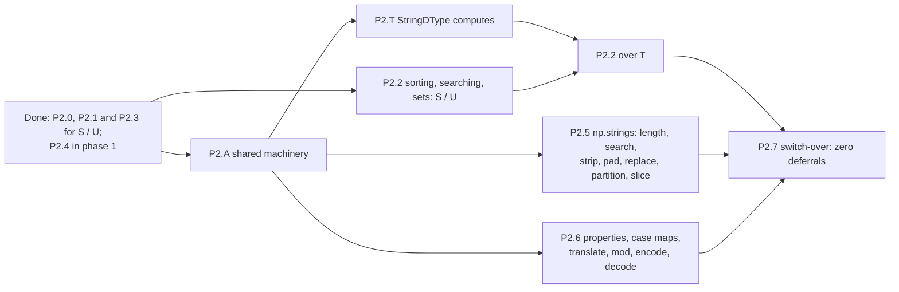

# Strings, phase 2 — computing on text (S / U / StringDType): implementation plan

> Plan for Stage D phase 2 of `docs/plans/dtype-system.md`: every computation NumPy 2.4.2 runs on text — the fixed-width
> dtypes (`bytes_` = `S`, `str_` = `U`) and, since the owner's direction of 2026-10-10, NEP 55 `StringDType` (`T`).
> Phase 1 (`docs/plans/strings-phase1-completion.md`) holds text as data for all three dtypes and defers every
> computation with `StringComputationNotSupportedException`. This plan replaces those deferrals with computation.
>
> The work is split into stages, each a family of functions that share one technique (§4). Every technique choice
> rests on a measurement taken for this plan: NumPy's own timings and C# prototypes of the candidate kernels on the
> same data and the same pinned cores — first for the subphases of 2026-10-09 (§2.1–§2.4), then, on 2026-10-15, for
> EVERY function still to implement, over `S`, `U` and `T` data (§2.5): which of the existing machineries (the IL text
> kernels, NDIter, whole-array IL kernels, NDExpr fusion, hand-written SIMD) gives the fastest exact result, for every
> NDArray layout, flag, storage state and kind of data. §3.2 records the decisions that discovery took, §4 the stages
> re-planned around them, Appendix C the implementation of every function and Appendix D the route of every NDArray case.
>
> Source of truth: `refs/numpy/` (**2.4.2**) — `numpy/_core/src/umath/{string_ufuncs.cpp, stringdtype_ufuncs.cpp,
> string_buffer.h, string_fastsearch.h}`, `numpy/_core/src/multiarray/stringdtype/{dtype.c, static_string.c}`,
> `numpy/_core/src/multiarray/unique.cpp`, `numpy/_core/strings.py`, `numpy/_core/defchararray.py`,
> `numpy/_core/src/npysort/{quicksort,mergesort,timsort,heapsort}.cpp`,
> `numpy/_core/src/multiarray/{arraytypes.c.src,scalartypes.c.src}`, `numpy/lib/_arraysetops_impl.py`.
> All behaviors and timings below were probed against `numpy==2.4.2` on CPython 3.12.12 (win-amd64, i9-13900K,
> two P-cores pinned with `start /affinity 14`) on 2026-10-09 and 2026-10-15.

---

## 0. Where phase 2 stands (2026-10-15, after P2.2 milestone A)

Commit hashes in this plan: the branch was rebased onto journey4 on 2026-10-12, so the hashes of §0's first edition and
of the 2026-10-09 state-log entries are the OLD ones; `git log -1 --format=%B a8d7f17c | grep -- '->'` translates them
(`7c817644` → `62f41584`, `cc8b103f` → `68348bcf`, `31368171` → `f18ae600`, `3eb9cca5` → `b4983b7a`). The deferral
counts below were taken at `545818b0` and re-counted at `ee6e121a`, unchanged: the commits between are dtype work (the
lock-free cast table `07903e85`; NumPy's member names in the DTypes folder, `8de98557` = journey4's `6f11dc5a`,
`ea8174aa`, `c3915f2a`; the release notes `a911607a`), this plan (`e4485fec`) and phase 1's P1.7c (`f5f3e634`, notes
`ee6e121a`), which added the `tio` section and no deferred case.

| Part | State |
|---|---|
| Phase 1 (text as data for `S`, `U`, `T`) | Done except P1.7f (the whole surface with `T`), which waits for the owner's decision D12 (`strings-phase1-completion.md` §6.2). P1.7f's `tsurface` oracle section is where the `np.*` calls that compute on `T` get their deferred cases (today only numpy.ma reaches them, section `tma`). P1.7c (text I/O for `T`) landed in `f5f3e634` with two engines phase 2 reuses: CPython's codec layer (`IO/TextReading/PythonCodecs{,.Tables}.cs`, `TextIOCodec*.cs`: codec names and aliases, UTF-8 / -sig / -16 / -32, Latin-1, ASCII, 70 single-byte code pages, CPython's strict-error texts and positions) and CPython's `%` formatting (`Backends/Printing/PercentFormat.cs`, a port of `PyUnicode_Format`) — P2.6's `encode` / `decode` / `mod`. |
| P2.0 foundations | Done (`62f41584`): the IL text kernels (`Backends/Kernels/ILKernelGenerator.Text{,.Emit}.cs`): one DynamicMethod per (operation, unit, widths, operand order), emit-time chunk plans, broadcast-pattern stages. The Unicode tables moved to the stage that first reads them (§4, P2.A). |
| P2.1 comparisons and truth | Done for `S` / `U` (`62f41584`, `68348bcf`; oracle section `strcomp`, 8,796 cases, zero excuses). Left: the `T` forms (§4, P2.T) and `np.char`'s stripping comparisons (`np-char.md` C1). |
| P2.3 concatenation and repetition | Done for `S` / `U` (`f18ae600`; section `strarith`, 2,046 cases). Left: the `T` forms (P2.T), `np.char.add` / `np.char.multiply` (`np-char.md` C0 / C4). |
| P2.A shared machinery | Part 1 done (2026-10-15, `b8003693`, the rows contract D16 and the masked blend D17, retrofitted to the shipped comparison and truth kernels; state log). Left: the unary text driver and width-class helpers (with P2.5), the `T` kernel shell (with P2.T), the Unicode tables and the sticky escalation (with P2.6) — each lands with its first consumer, the roadmap's recommended order. |
| P2.2 sorting, searching, set routines | Milestone A done (2026-10-15, `9771aa9c`, state log): `np.sort` / `np.argsort` / `ndarray.sort` / `np.partition` / `np.argpartition` over `S` / `U` with NumPy's `kind` / `order` / `stable`, NumPy's order of equal strings included (its introsort replayed); oracle section `strsort` (4,998 cases, zero excuses). Left: milestone B (`argmax` / `argmin` / `nanargmax` / `nanargmin`, `searchsorted`, `digitize`), milestone C (`unique` and its Array-API forms, `isin`, the set routines, `lexsort`, `sort_complex`, the histograms, the discontinuous quantiles), and the `T` part (after P2.T). |
| P2.4 casts between text and numbers | Moved to phase 1 by the owner (2026-10-10) and done there (P1.1 for `S` / `U`, P1.6 for `T`). The parse-fed numerics, the random bounds and seeds, numpy.ma's number fills and the bool → text cast all compute now. |
| Deferral sites | 39 call sites left (counted after P2.2 milestone A, which removed `AxisSort`'s and `AxisPartition`'s three): 30 `NDStringUfuncs.NextPhase` (fixed width) and 9 `NDStringUfuncs.NextPhaseVString` (`T`). `NDStringCasting.TextConversion` and `NDStringCopy.MixedKinds` have no caller since P1.1. Appendix A maps every site to a stage. |
| The gate | The string oracle (`test/oracle/gen_strings_oracle.py` → `NumSharp.Tests.Oracle/Strings/corpus/strings_<section>.jsonl`, 34 sections, 82,890 cases since P2.2 milestone A's `strsort`). 783 of them still pass only as deferrals (the per-section ceilings of `StringOracleTests.DeferralCeilings`): 346 `S` / `U` cases of searching, the set routines, histograms and quantiles, and 437 `T` cases reached through numpy.ma. Appendix B lists them by stage. |
| Iteration and machinery | `np.nditer` and `NDIter` carry string operands with NumPy's descriptors (`4d5b9f26`) and, since P1.7g (`97a168bf`), NumPy's own buffering: element sizes, string buffers, casts between every string dtype and the numbers, `T` buffers with their own allocators. This is the iteration base of every phase-2 kernel. |
| Refusals and shape-decided answers | Where NumPy has no string loop, NumSharp raises NumPy's type and text, after NumPy's earlier checks in NumPy's order (`Backends/Strings/NDStringUfuncs{,.Precedence,.ShapeDecided,.VString}.cs`); empty inputs, lines of one element and pairs the `==` operator cannot compare are answered from the shape. These stay. |

---

## 1. What NumPy 2.4.2 does

### 1.1 The ufunc loops (`string_ufuncs.cpp`, `string_buffer.h`)

Every loop builds a `Buffer<enc>` per element (`ASCII` for `S`, `UTF32` for `U`) and works one code unit at a time.

| Ufunc | Loops | Output | Per-element algorithm |
|---|---|---|---|
| `equal`, `not_equal`, `less`, `less_equal`, `greater`, `greater_equal` | (S,S), (U,U) only | bool | `strcmp`: compare the common prefix unit by unit as UNSIGNED values (`npy_ucs4` / `unsigned char`), then any nonzero unit in the longer operand's tail makes it greater. So trailing NULs never count (`'a' == 'a\0'`), embedded NULs do. |
| `add` | (S,S), (U,U) | the first class, width `w1 + w2` | copy `num_codepoints(a)` units, then `num_codepoints(b)` units, zero-fill the rest. |
| `multiply` | (S,int64), (int64,S), same for U | `out=` required | repeat `num_codepoints(a)` units `reps` times, truncated to the out width; `reps < 1` → empty. |
| `str_len` | S, U | intp | `num_codepoints` = index of the last nonzero unit + 1. |
| `isalpha`, `isdigit`, `isspace`, `isalnum`, `islower`, `isupper`, `istitle` | S (ASCII rules), U (`Py_UNICODE_IS*`) | bool | every code point satisfies the predicate; an empty string is False; `islower` / `isupper` / `istitle` use CPython's cased logic. |
| `isdecimal`, `isnumeric` | U only | bool | as above; no S loop. |
| `find`, `rfind`, `index`, `rindex`, `count` | (S,S,i64,i64), (U,U,i64,i64) | intp | CPython's `adjust_offsets` on `start` / `end`, then `fastsearch` (results only depend on the match semantics). `index` raises `ValueError("substring not found")`. |
| `startswith`, `endswith` | as `find` | bool | `tailmatch`. |
| `_lstrip_whitespace` … `_strip_chars` | S, U | the input dtype | ASCII whitespace for S, `Py_UNICODE_ISSPACE` for U. |
| `_replace`, `_expandtabs(_length)`, `_center`, `_ljust`, `_rjust`, `_zfill`, `_partition_index`, `_rpartition_index`, `_slice` | S, U (`_center` family also mixes an S buffer with a U fill char) | `out=` required (the Python wrappers size it) | per element; `_slice` follows `PySlice_AdjustIndices`. |

The comparison loops are also used by `compare_chararrays` with `rstrip=True` (strip trailing NULs and ASCII
whitespace first), which `np.char.equal` … `np.char.less_equal` call.

### 1.2 The Python layer (`numpy/_core/strings.py`)

Most `np.strings` functions are TWO passes of ufuncs: a length pass and the main loop into an output of the exact
width. Example, `multiply`: `a_len = str_len(a)`; an overflow check; `buffersizes = a_len * i`;
`out = np.empty_like(a, shape=buffersizes.shape, dtype=f"{a.dtype.char}{buffersizes.max()}")`; then the ufunc with
`out=`. `center`, `zfill`, `replace`, `expandtabs` and `partition` follow the same shape. So the output width is
DATA-dependent (`np.strings.multiply(['a', 'bb'], [3, 2])` is `<U4`).

Nine `np.strings` functions and `np.char.join` run per element through CPython's own `str` / `bytes` methods
(`_vec_string`):
- `upper`, `lower`, `swapcase`, `capitalize`, `title` and `translate` write into the INPUT dtype, so CPython's full
  case mapping is truncated: `upper('ß')` is `'SS'`, and `'ßa'` in `<U2` becomes `'SS'`;
- `mod`, `encode`, `decode` and `np.char.join` go through an object array, and `_to_bytes_or_str_array` sizes the
  result from the longest element.

### 1.3 `np.char` (legacy)

`np.char` re-exports 36 `np.strings` functions. Its own: the six rstrip comparisons, `compare_chararrays`,
`multiply`, `join`, `partition` / `rpartition` (one array with a last axis of 3, not a tuple), `split` / `rsplit` /
`splitlines` (object arrays), `array`, `asarray`, `chararray`.

### 1.4 Sorting and searching

- `np.sort` / `np.argsort`: `string_quicksort_` / `string_aquicksort_` (`npysort/quicksort.cpp`): introsort
  (median of three, `SMALL_QUICKSORT = 15`, insertion sort, `string_aheapsort_` past depth `2·msb(n)`), comparing with
  `STRING_LT` / `UNICODE_LT` (unsigned units over the item width). It is NOT stable: with duplicates the index order
  is the algorithm's (probed: `[29, 15, 13, 21, …]` where a stable sort gives `[1, 3, 5, 7, …]`). `kind='heapsort'` gives
  the same permutation as the default for `S` / `U` (probed; over `T` it raises, §1.9). `kind='stable'` / `'mergesort'`
  use the stable string sorts.
- `np.partition` / `np.argpartition`: no selection loop for strings, so `PyArray_ArgPartition` falls back to the
  GENERIC `npy_aquicksort` with the dtype's compare function (`item_selection.c`). Its scans carry an extra
  `pi < pj` guard, which stops them exactly where `string_aquicksort_`'s unguarded scans stop (the element at the old
  `pj` is never below the pivot), so the permutation is the same: probed, `argpartition` returns the default
  `argsort`'s permutation. One port serves both.
- `np.argmax` / `np.argmin`: `STRING_argmax` / `UNICODE_argmax`, first occurrence. `np.max` / `np.min` stay
  refusals (no `maximum` loop).
- `np.searchsorted`: the generic binary search with the dtype's compare function.
- `np.unique`: values only → a hash table (`unique_string`, `unique.cpp`), then a sort; `return_index` → a stable
  argsort; `return_inverse` / `return_counts` → independent of the tie order. Set routines, `isin`, `lexsort`
  (stable argsorts) and `digitize` compose these.

### 1.5 Casts between text and numbers

Legacy per-element casts through Python objects (`getitem` → `setitem`):

- Number → text is the NumPy scalar's `str()`: Dragon4 shortest digits, positional from `1e-4` up to `1e3` for
  float16, `1e6` for float32, `1e16` for float64 (`scalartypes.c.src`), scientific otherwise
  (`'1e+04'`, `'6.55e+04'`, `'1.6777216e+07'`, `'1e+20'`); complex is Python's repr (`'(1+2j)'`, `'(-0-1j)'`,
  `'1e+20j'`); bool is `'True'` / `'False'`. The result is cut to the target width (`astype('U3')` of `123.456` is
  `'123'`). Default widths: bool 5, int8 4, int64 21, uint64 20, floats 32, complex 64.
- Text → number is CPython's `int()` / `float()` / `complex()` on an `np.str_` / `np.bytes_`: whitespace,
  underscores (`'1_000'`) and Unicode digits (`'١٢'` → 12) are accepted, `'1e400'` → inf. Errors:
  `invalid literal for int() with base 10: np.str_('1.5')`, `could not convert string to float: np.bytes_(b'\xff')`,
  `complex() arg is a malformed string`, and the pack check's `OverflowError: Python integer 300 out of bounds for
  int8`.
- Text → bool is truthiness: non-empty is True (`'\0'` and `''` are False, `'False'` is True).

### 1.6 Truth values

`astype(bool)`, `np.nonzero`, `count_nonzero`, `np.any` / `np.all` and `logical_and` / `or` / `xor` (any operand mix)
all read a string's truth value through the text → bool cast. `logical_not` has no loop (TypeError, probed).

### 1.7 Unicode data

`Py_UNICODE_IS*` and the case mappings come from the running CPython's database: 3.12.12 → Unicode **15.0.0**.

### 1.8 `StringDType` (`T`) loops (`stringdtype_ufuncs.cpp`, `stringdtype/dtype.c`, `unique.cpp`)

NumPy registers `T` loops for: the six comparisons, `isnan`, the nine predicates (`isalpha` … `islower`, `isdecimal`,
`isnumeric`), `str_len`, `add`, `multiply` (both orders), `maximum` / `minimum`, `find` / `rfind` / `index` / `rindex` /
`count`, `startswith` / `endswith`, the six strip loops, `_replace`, `_expandtabs`, `_center` / `_ljust` / `_rjust`,
`_zfill`, `_partition` / `_rpartition` and `_slice`. Every loop works one element at a time: `NpyString_load` of each
operand cell (the 16-byte cell of `static_string.c`: a short string inside it, a medium / long one in the per-buffer
arena or on the heap), a `Buffer<UTF8>` over the bytes, and for an output a `load_new_string` / `NpyString_pack` through
the output's allocator (acquired once per call). Positions and lengths are in CODE POINTS (`str_len('é中😀')` is 3,
`find` returns a code-point index), so a non-ASCII element is decoded or counted.

The Python layer calls the `T` ufunc directly — no size pass, no `out=` (`multiply`: `a * i`; `center`: `_center(a, width,
fillchar)`; `replace`: `_replace(arr, old, new, count)`; `expandtabs`, `zfill`, `partition`). `upper`, `lower`,
`swapcase`, `capitalize`, `title`, `translate`, `mod`, `encode`, `decode` and the `np.char` object functions go through
`_vec_string` over Python `str` objects, as for `U`.

Sorting is generic: `npy_quicksort_impl` / `npy_mergesort_impl` (and the `a` forms) over the 16-byte cells with
`_sort_compare` → `_compare` (an `NpyString_load` of both cells per comparison, the allocator held for the whole sort);
`np.argmax` / `np.argmin` call `compare` (which acquires and releases the allocator per comparison); `np.unique` hashes
(`unique_vstring`: FNV-1a over the UTF-8 bytes into a `std::unordered_set`, then a sort).

**Missing values** (probed on 2026-10-15; `nan` = a NaN-like `na_object`, `None` = any other non-string object, `'NA'`
= a string `na_object`):

| Call | `nan` | `None` | `'NA'` |
|---|---|---|---|
| `==` / `!=` / `<` … | every comparison with an NA is `False` (`!=` too) | `==` / `!=` by null-ness (two NAs equal); ordering raises `'less' not supported for null values that are not nan-like or strings.` | the NA is the string `'NA'` |
| `np.sort` / `argsort` / `np.unique` / `np.max` | NA sorts last; `np.max` is `nan` | `ValueError: Cannot compare null that is not a nan-like value` (only when a comparison happens: one element sorts fine) | `'NA'` |
| `add` / `np.sum` | NA propagates (`np.sum` is `nan`) | `ValueError: Cannot add null that is not a nan-like value` | `'NA'` concatenated |
| `str_len` | `ValueError: The length of a null string is undefined` | the same | 2 |
| `isalpha` (predicates) | `False` for the NA | `ValueError: Cannot use the isalpha function with a null that is not a nan-like value` | the predicate of `'NA'` |
| `find` family | `ValueError: 'find' not supported for null values that are not strings.` | the same | the search in `'NA'` |
| `center` / `strip` / `replace` | NA propagates | `Cannot _center null …` / `Can only strip null values …` / `Only string or NaN-like null strings can be used as search strings for replace` | `'NA'` processed |
| `upper` (the `_vec_string` path) | `TypeError: descriptor 'upper' for 'str' objects doesn't apply to a 'float' object` | `… a 'NoneType' object` | `'NA'` upper-cased |
| `astype(bool)` / `isnan` | `True` / `True` | `False` / `False` | `False` / `False` |

### 1.9 NumPy behaviors the 2026-10-15 discovery found

- **`np.sum` over `T` is quadratic.** `add.reduce` writes the accumulator back through the `add` loop, so every step
  copies the whole running string: 0.48 / 2.1 / 34 / 507 ms at 1K / 4K / 16K / 64K elements of 1–8 characters (a 288 KB
  result). A linear concatenation gives the same string (§3.2 D18).
- **`np.strings.partition(t, 'a')` raises** `UFuncTypeError: ufunc '_partition' did not contain a loop with signature
  matching types (<class 'numpy.dtypes.StringDType'>, <class 'numpy.dtypes.StrDType'>) -> (None, None, None)`: the `T`
  partition loops take a `T` separator only (`np.array('a', dtype=T)` works). Reproduce the refusal.
- **An `S` array with a `str` argument** (`np.strings.find(s, 'ab')`, `strip(s, 'ab')`, `startswith`, `count`, `rfind`,
  `endswith`) is NumPy's `UFuncTypeError` (no `(S, U)` loop): the `S` forms take `bytes`.
- **`np.unique(t, sorted=False)`** returns NumPy's hash order (first occurrence in the probe), which C# does not
  reproduce; NumSharp returns sorted values, the documented divergence of the numeric `unique_values`.
- **`T` sorting, `argmax` and `max` follow `_compare`'s asymmetric answer for NaN-like NAs.** `_compare` returns 1
  ("greater") whenever its FIRST argument is a NaN-like NA, another NA included, so two NAs have no consistent order
  (probed at 40 / 1K / 100K elements): `np.argsort(t)` (the generic introsort) puts the NAs last in the order its own
  comparison sequence leaves them (`[36, 34, 33, 3, 4, 30, …]`); `kind='stable'` / `'mergesort'` (the generic mergesort,
  which only asks whether the later element is less than the earlier one) keeps them in input order; `np.argmax`
  returns the LAST NA (`['b', nan, 'c', nan, 'a']` → 3: the generic loop takes index `i` when
  `compare(x[i], x[max]) > 0`, and every later NA answers 1); `np.argmin` the first smallest text (all NA → 0). The NA is
  the greatest element: `np.max` / `maximum` return it, `np.min` / `minimum` the smallest text. With a `None` NA each of
  them raises `ValueError: Cannot compare null that is not a nan-like value` at its first comparison; a string NA is
  its default string.
- **`kind='heapsort'` over `T` raises** `RuntimeError: unsupported sort kind` (`np.sort`, `np.argsort`, `ndarray.sort`):
  NumPy's `T` sort ArrayMethod (`stringdtype_get_sort_loop` / `stringdtype_get_argsort_loop`) accepts only the default
  kind (the generic introsort) and the stable kind (the generic mergesort). `S` / `U` accept it.

---

## 2. Measurements that decide the techniques

Data: N random lowercase strings of 1–8 characters as `<U8` (32 bytes) and `|S8`; a 100-value categorical set for the
duplicate-heavy cases. NumPy timed with `time.perf_counter` (best of rounds); C# prototypes are standalone
`dotnet run -c Release` programs on raw unmanaged buffers, `DOTNET_TieredCompilation=0`, the same two pinned cores.
The prototypes exclude NumSharp's fixed per-call cost (an NDArray result and an iterator: about 0.2–0.5 µs).

### 2.1 Elementwise text kernels (µs; NPY/NS = NumPy ÷ prototype)

| Operation | NumPy 1K / 100K / 1M | Prototype 1K / 100K / 1M | NPY/NS |
|---|---|---|---|
| `u == v` (`<U8`) | 16.4 / 2,224 / 22,888 | 1.1 / 165 / 3,062 | 15 / 13.5 / 7.5 |
| `u < v` (`<U8`) | 16.4 / 2,292 / 23,994 | 2.0 / 207 / 3,319 | 8.2 / 11 / 7.2 |
| `u == 'abcd'` | 17.3 / 1,675 / 17,099 | 0.8 / 108 / 1,634 | 22 / 15.5 / 10.5 |
| `<U8 == <U4` | 16.4 / 2,213 / 22,830 | 1.2 / 144 / 2,360 | 14 / 15 / 9.7 |
| `u[::2] == v[::2]` | 8.8 / 1,102 / 11,765 | 0.7 / 148 / 2,835 | 13 / 7.4 / 4.2 |
| `s == t` (`\|S8`) | 16.3 / 2,219 / 22,877 | 0.8 / 81 / 830 | 20 / 27 / 28 |
| `s < t` (`\|S8`) | 16.3 / 2,290 / 23,650 | 1.0 / 104 / 1,057 | 16 / 22 / 22 |
| outer `(1000,1) == (1,1000)` | 22,705 | 881 | 26 |
| `u.astype(bool)` | 211 / 21,790 / 214,503 | 0.8 / 108 / 1,847 | 260 / 200 / 116 |
| `str_len(u)` | 3.5 / 1,408 / 16,765 | 1.4 / 146 / 2,418 | 2.5 / 9.6 / 6.9 |
| `np.add(u, v)` | 18.9 / 5,018 / 60,494 | 2.1 / 383 / 5,876 | 9.0 / 13 / 10 |

The prototype kernels compare a whole element at once: a `<U8` element is exactly one `Vector256`, so equality is one
compare and one `EqualsAll`, ordering one compare plus a `movemask` / trailing-zero count to the first differing unit,
the length one compare with zero plus a leading-zero count, `add` two loads and three stores. NumPy's loop builds a
`Buffer` per element, scans trailing NULs and compares one unit per step (~22 ns per element).

### 2.2 Sorting and searching (µs)

| Operation | NumPy 1K / 100K / 1M | Prototype 1K / 100K / 1M | NPY/NS |
|---|---|---|---|
| `np.argsort(u)`, plain port of `string_aquicksort_` | 30.8 / 16,911 / 239,562 | 11.9 / 12,795 / 190,366 | 2.6 / **1.32** / **1.26** |
| same, the port run over (64-bit key, index) records | | 12.1 / 6,803 / 81,182 | 2.5 / 2.5 / 3.0 |
| `np.argsort(categorical)`, plain port | 42.4 / 12,117 / 157,723 | 10.9 / 8,661 / 115,107 | 3.9 / **1.40** / **1.37** |
| same, over key records | | 11.4 / 3,968 / 42,369 | 3.7 / 3.1 / 3.7 |
| `np.argsort(u, kind='stable')`, LSD radix over the keys | 55.1 / 21,167 / 362,879 | 190 / 2,342 / 28,325 | **0.29** / 9.0 / 12.8 |
| `np.sort(u)` (NumPy only) | 70.6 / 17,004 / 200,803 | | |
| `np.argmax(u)`, first-unit filter | 3.0 / 180 / 2,172 | 0.3 / 94 / 1,686 | 10 / 1.9 / **1.29** |
| `np.searchsorted(sorted, v)` (NumPy only) | 81 / 34,981 / 1,385,798 | | |
| `np.unique(categorical)` / `np.unique(u)` (NumPy only) | 43 / 3,893 / 41,929 · 147 / 35,098 / 526,976 | | |

Findings:
- A faithful introsort port is NOT enough (1.26–1.40× at 100K / 1M): the time goes to random access into the string
  buffer through the index array, not to the compare.
- Running the SAME introsort over contiguous (key, index) records, where the key is the string's order-preserving
  64-bit prefix, answers every comparison identically, so the permutation is NumPy's. The prototype checked this
  index for index against the plain port on both data sets. It runs at 2.5–3.7×.
- A stable radix sort over the keys reaches 9–13× at 100K / 1M. Its 16-bit buckets cost 190 µs at 1K, so small inputs
  need another algorithm (§3 D3).
- `argmax` at 1M reads every cache line on both sides: 1.29× is the memory-bandwidth floor of a `<U8` array.

### 2.3 Casts (µs)

| Operation | NumPy 1K / 100K / 1M | Prototype 1K / 100K / 1M | NPY/NS |
|---|---|---|---|
| int64 → `<U21` (native itoa) | 193 / 22,045 / 222,899 | 26.6 / 3,010 / 30,358 | 7.3 / 7.3 / 7.3 |
| `<U21` → int64 (native parse) | 313 / 31,850 / 325,014 | 19.0 / 2,322 / 23,845 | 16 / 14 / 14 |
| float64 → `<U32` (.NET `TryFormat`, shortest) | 510 / 59,000 / 589,224 | 318 / 34,731 / 348,501 | **1.6 / 1.7 / 1.7** |
| `<U32` → float64 (.NET `double.Parse`) | 550 / 56,462 / 568,200 | 301 / 32,133 / 321,623 | **1.8 / 1.8 / 1.8** |

The .NET formatter and parser cost 300–350 ns per float64 with 17–18 significant digits, which leaves no room for
NumPy's layout rules and CPython's parse grammar on top. The float casts need a fast shortest-digit algorithm and a
fast correctly rounded parser (§3 D6).

### 2.4 Unicode tables

CPython's string predicates against .NET's nearest APIs, all 1,112,064 non-surrogate code points (count that differ):

| Predicate | .NET 8.0.29 (Unicode 15.0) | .NET 10.0.1 (Unicode 16.0) |
|---|---|---|
| `isalpha` / `isalnum` | 0 / 0 | 4,924 / 5,004 |
| `isdecimal` | 0 | 80 |
| `isdigit` / `isnumeric` | 128 / 81 | 208 / 161 |
| `isspace` | 4 (`U+001C`–`U+001F`) | 4 |
| `islower` / `isupper` | 311 / 120 | 336 / 147 |
| `upper()` / `lower()` (one-character mappings) | 103 / 1 | 103 / 1 |

CPython defines `islower` / `isupper` by the derived Lowercase / Uppercase properties, `isdigit` / `isnumeric` by
`Numeric_Type`, and `upper` / `lower` by the full mappings (SpecialCasing); .NET uses the general category and simple
mappings. And the two target frameworks ship different Unicode versions, so .NET's APIs would make net8.0 and
net10.0 disagree with each other.

### 2.5 The 2026-10-15 discovery: every function left, over `S`, `U` and `T`

**Method.** NumPy: every remaining function at 1K / 100K / 1M elements, best of rounds after a 250 ms warm-up, on data
variants that separate the cases the kernels branch on — `u8` / `s8` / `t8` (random lowercase ASCII, 1–8 characters),
`u8n` / `t8n` (the same with 20 % of the characters from `é ß α ω א 中 😀 Ж`), `u40` / `t40` (20–40 characters: `T`
arena strings), `u10s` (1–6 letters with 0–2 spaces on each side), `u8d` (digits), `u8tab` (tabs), `u8cat` (100 distinct
values), `tna` (`na_object=nan`, 10 % NA). C#: six rounds of prototypes, each a raw-pointer kernel over the SAME arrays
(loaded through `np.load_npy`, `T` arrays through NumSharp's own cells and arenas), checked against a scalar reference of
NumPy's semantics before it is timed, warmed to tier 1 (250 ms, a 100 ms sleep, three calls), both sides pinned to two
P-cores. The prototypes exclude NumSharp's per-call driver; measured on the existing comparison route, that driver adds
0.7 µs at 1K and nothing measurable at 100K / 1M ("What the machinery measured" below). The scripts are in the 2026-10-15
session's scratchpad (`disc/np_bench*.py`, `disc/proto{,2..6}.cs`, not tracked).

**What NumPy costs** (ns per element at 100K; 1M is within ±15 % except where noted; "1K µs" = the whole call at 1K,
where Python-level compositions dominate):

| Family | `U8` | `S8` | `T8` | NumPy's implementation |
|---|---|---|---|---|
| `str_len` | 13.5 | 12.9 | 14.6 (`T8n` 34.6, `T40` 60.8) | C loop (`T`: UTF-8 count) |
| predicates (`isalpha` … `isnumeric`) | 18–34 | 16–26 | 20–47 (`T8n` 61) | C loop, `Py_UNICODE_IS*` per unit, early exit |
| `find` / `rfind` / `count` / `startswith` / `endswith` | 15–31 (`U40` 69–71) | 15–32 | 26–47 (`T40` 250–259) | C loop, `fastsearch` |
| `upper` / `lower` / `swapcase` / `capitalize` / `title` | 298–345 (`U8n` 369–371) | 111–117 | 155–197 (`T8n` 308–312) | `_vec_string` |
| `strip` family (whitespace, chars) | 30–45 | 29–42 | 90–106 | C loop |
| `center` / `ljust` / `rjust` / `zfill` | 61–77 (1K 35–51 µs) | 38–42 | 73–80 | Python sizing + C loop (`T`: C loop) |
| `replace` | 95–107 (1K 80–84 µs) | 106 | 118–121 | Python sizing + C loop |
| `partition` / `rpartition` | 101 (1K 82 µs) | 96–97 | 85–88 | Python sizing + C loop into a structured array |
| `slice` (`1:5`, `::-1`) | 27.5–28.4 | 22.5–23 | 52–66 | C loop |
| `expandtabs` | 118 | 71 | 197 | Python sizing + C loop |
| `translate` / `mod` / `encode` / `decode` | 840 / 579–836 / 634–703 / — | 189 / — / — / 516 | 687 / — / 500 / — | `_vec_string` |
| `T` comparisons; `add` / `multiply` / `maximum` | — | — | 10.7–11.1 (`T40` `==` 31.7); 34–42 / 49 / 28 | C loop |
| `T` `max` / `min` / `argmax`; `isnan` / `astype(bool)` / `nonzero` | — | — | 11.3 / 11.2 / 53.7; 2.5 / 1.6 / 5.6 | reduce loop / generic argmax / C loops |
| `T` `np.sum` / `np.cumsum` | — | — | quadratic (1K: 178 µs / 2,514 µs) | `add.reduce` / `add.accumulate` |
| `sort` / `argsort` / stable `argsort` | 167 / 167 / 211 (1M 200 / 244 / 393) | 160 / 159 / 176 | 381 / 337 / 686 (1M 459 / 473 / 420) | introsort (string compare); `T` generic over cells |
| `unique` / `searchsorted` / `isin` (100) / `partition` (k) / `lexsort` | 408 / 363 / 269 / 220 / 607 (1M: 563 / 1,640 / 364 / 272 / 1,167) | 254 / 252 / 233 / 195 / — | 1,162 / 1,303 / 2,639 / 1,025 / — | hash + sort; binary search; compositions |
| `argmax` | 1.8 | 3.0 | 53.7 | `STRING_argmax` / `UNICODE_argmax`; `T` generic |

**What the candidate techniques measured** (kernel only; NPY/NS = NumPy ÷ prototype at 1K / 100K / 1M; the chosen
technique of each row first):

| Function | Technique | NPY/NS 1K / 100K / 1M |
|---|---|---|
| `str_len` `U8` / `S8` | emit-time-width chunks + leading-zero count / one 64-bit read + leading-zero count | 2.6 / 9.7 / 7.6 · 4.9 / 16.4 / 18.4 |
| `str_len` `T8` / `T40` | two short cells per `Vector256` (size byte broadcast in each half by `vpshufb`, continuation bytes counted) / overlapping 16-byte chunks over the arena text (a scalar tail instead: 8.3 / 3.4 / 3.4) | 5.7 / 11.3 / 11.4 · 18 / 7.6 / 7.3 |
| `isalpha` `U8` (ASCII) | emit-time width / a masked-load width class (C#, one `vpmaskmovd` per element) | 8.7 / 10.7 / 9.4 · 8.3 / 10.0 / 8.7 |
| `isalpha` `U8n` (non-ASCII) | one `vpgatherdd` per element from a flags word per BMP code point / a scalar two-stage table on every lane / a table on the non-ASCII lanes only / .NET `Rune` | 5.8 / 4.2 / 4.0 · 1.7 / 2.2 / 2.2 · 4.8 / 1.8 / 1.7 · 3.3 / 1.1 / 1.1 |
| `isalpha` `S8` / `T8` | four elements per `Vector256` / two cells per `Vector256` | 8.4 / 12.1 / 12.2 · 21.6 / 21.7 / 21.8 |
| `find('ab')` `U8` / `S8` / `T8` | AND of the two lane-equality masks, the second shifted one lane / the same, four elements per vector / one `Vector128` per short cell + the continuation bytes before the match | 7.8 / 11.6 / 9.3 · 7.6 / 12.8 / 13.1 · 23.1 / 23.8 / 23.6 |
| `find('ab')` `U40` / `T40` | 64-bit masks over five vectors / span search + code-point count | 4.5 / 5.7 / 4.8 · 35 / 20.8 / 20.6 |
| `count('a')` / `startswith('ab')` `U8` | popcount of the equality mask / one masked vector compare | 17.7 / 22.0 / 13.5 · 12.1 / 14.1 / 9.8 |
| `upper` `U8` / `S8` / `T8` (ASCII) | a-z flipped in the lanes / 32 bytes per vector / two cells per vector, in the cell | 208 / 156 / 105 · 554 / 413 / 232 · 257 / 186 / 119 |
| `upper` `U8n` | ASCII flip + a table lookup per non-ASCII lane | 155 / 32 / 28 |
| `strip` `U10` (whitespace) | whitespace / length masks, then a masked load from the first kept unit / register permutes / a stack row (store, reload at the offset) | 2.2 / 5.9 / 5.8 · 1.5 / 4.0 / 4.0 · 1.5 / 4.2 / 4.2 |
| `center(12)` `U8` → `U12` | register permutes (`vpermd` by lane − left) / masked loads from element − left / a stack row | 12.5 / 18.8 / 16.4 · 9.8 / 14.5 / 14.2 · 6.7 / 9.1 / 8.8 |
| `replace('a', 'xy')` `U8` | fused count + size pass, then segment copies (a permute and a whole-vector store per match) / a branch-free unit loop / a branchy unit loop | 7.6 / 9.9 / 8.8 · 6.7 / 4.7 / 4.5 · 10.4 / 4.6 / 4.5 |
| `T8 ==` / `T8 <` | two cells per `Vector256` (text masked to its size, byte 15 kept: the cell IS the order) / one 128-bit number per cell (scalar) / a branch on the first differing byte | 8.4 / 7.2 / 6.5 · 4.7 / 4.2 / 4.0 (scalar: 2.7 / 1.5 / 1.5; branch: 3.4 / 0.7 / 0.7) |
| `T8` `max` / `sum` | the winner's index by comparisons only, one copy at the end / one size pass, one buffer, 16-byte cell copies | — / 6.2 / 6.0 · 89 at 1K (NumPy quadratic; 1M: 3.1 ms) |
| `argsort` `T8` / `U8` | (64-bit key, size, index) records sorted by NumPy's introsort control flow / the same records from `<U8` | 8.0 / 3.2 / 3.9 · 1.8 / 1.9 / 2.2 |

The `U8` `argsort` row read 2.6 / 2.5 / 3.0 on 2026-10-09 with the same algorithm: the host's clock is not constant
(2.8–3.4 GHz under load), so a technique is compared with another within ONE run, never across sessions.

**What the machinery measured.**
- **Emit-time widths.** A C# kernel with the width as a loop bound costs 25 % (`str_len`) to 50 % (`isalpha`) against the
  emit-time-width kernel; one masked load per element with a per-call lane mask (`vpmaskmovd`) costs 7 % (`isalpha`
  `U8` 2.7 against 2.5 ns per element; `U5` 2.9 ns). The IL text kernel itself runs at the hand-written C# kernel's speed
  (`u8 == u8b`: 152 / 2,884 µs through the public operator against 157 / 2,817 µs for the C# prototype at 100K / 1M,
  the IL-vs-C# finding of the polynomial work).
- **Narrow rows.** `m[:, :3] == "abc"` over a (1000, 100) `U8` matrix (3,000 elements): 19.3 µs through NDIter — one
  kernel call per 3-element row, about 15 ns per row (the iterator step and the kernel's per-call prologue, which also
  re-hoists the broadcast needle); a copy then the contiguous compare 8.2 µs; one call per row without an iterator 4.3 µs;
  one call for all the rows, the kernel walking them, 2.4 µs. NumPy: 60.6 µs.
- **`where=`.** `np.equal(u8, u8b, out, where=mask)` (two thirds true, random) at 100K: 426 µs through NDIter's per-run
  calls (4.3 ns per element against 1.5 unmasked); 32 results computed and blended with the mask in one vector store:
  173 µs (1.7 ns).
- **Fusion.** `(u8 == "abc") & (ints > 50000)` takes 157.7 µs at 100K unfused, of which the text comparison is 129.4 and
  the integer comparison 18.4: one fused pass can save at most ~18 % (1K: 4.8 against 2.4 + 1.1 µs; 1M: 2,619 against
  1,928 + 237 µs).
- **Branches on the data.** The first scalar `T` comparison branched on which byte was smaller and ran at 14.5 ns per
  element, slower than NumPy (0.7×); the branch-free scalar forms reach 7–9 ns, the two-cells-per-vector form 1.5. A
  per-element branch into a table path on `u8n` (about 58 % of its elements hold a non-ASCII unit) cost 16 ns per
  element against 7 for the branch-free gather. The JIT compiles C# ternaries over the data (`Math.Min`,
  `s >= 8 ? a : b`) to branches: read the disassembly (`DOTNET_JitDisasm`) of every per-element body.
- **Memory round trips.** Storing a vector and reloading it at a data-dependent offset (a stack row, the first `strip` /
  `center` prototypes) stalls on store forwarding: 8.5–11 ns per element where the register permute or masked-load form
  takes 4–8.

---

## 3. Technique decisions

### 3.1 The decisions of 2026-10-09 (D1–D10)

Kept as written, with their status: D1–D5 and D9 stand and are extended by §3.2 (D11, D12, D14, D19); D7 is refined
by D15 (the output width in one fused pass; NumPy's statements kept only where they decide an error or a dtype) and by
D11 / D13 (the search and shifting techniques); D6 (casts) moved to phase 1 with P2.4 and is done there; D8 (no fusion)
is confirmed by measurement (D20); D10 (a C# `string` operand) was decided in phase 1 (decision D6 there: a C# `string`
is a 0-d `U` array everywhere).

Phase 2 adds text kernels and parsers; everything around them already exists and is fast:

| Existing component | Phase-2 use |
|---|---|
| `NDIter` with string operands (`5477074f`): broadcasting, coalescing, buffering, `out=` / `where=`, overlap copies | every elementwise text kernel (D1) and every cast loop (D6) |
| The Tier-3A inner-loop contract and the once-per-call stride-pattern dispatch (`DirectILKernelGenerator.InnerLoop.BroadcastPatterns.cs`) | the text kernels' contiguous / broadcast / strided variants |
| The trivial-loop bypass (`TryTrivialBinaryOpInto`), `Shape.NpyIterOutputShape` | the fixed cost at 1K, NumPy's result layouts |
| Phase 1's `ElementCopy` / `WhereBytes` kernels, unit views, `NDStringCopy` | concatenation copies, the narrower-`out=` truncation, `np.where` over text |
| `RadixSort.ArgSortU64`, `AxisSort.DriveAllButAxis` | the stable kinds, sorts along an axis (D3) |
| The bool machinery: `nonzero` (count + bit scan), `count_nonzero`, the `any` / `all` reductions and their prologue, `np.where`, `compress` | truth values (D5) |
| The numeric ufuncs (`maximum`, `where`, `multiply`, `max`) | the `np.strings` size passes (D7) |
| `RandomSampling/PythonInt.cs` (CPython `int()`), the Dragon4 / `format_float_*` ports (`Backends/Printing`), `PyRepr`, `PrintfFormatter` (Python `%`; since `f5f3e634` driven by `PercentFormat`, a port of CPython's `PyUnicode_Format`), CPython's codec layer (`IO/TextReading/PythonCodecs`, `f5f3e634`) | text → int, the number → text layout rules, `np.str_('…')` in error texts, `np.strings.mod`, `np.strings.encode` / `decode` |
| The text↔number `CastingImpl`s (`DTypes/StringCastingImpls.cs`, `DTypes/CastingImpls.cs`: descriptor resolution) and the `ArrayMethod.get_strided_loop` seam | the cast loops (D6) |
| The set-routine and `unique` compositions (`np.setops.cs`, `NDArray.unique*.cs`) | P2.2, over the new text sort / compare primitives |

**D1. Elementwise text work = IL-emitted inner loops driven by NDIter.** One `DynamicMethod` per (operation,
encoding, operand widths, inner-stride pattern), with the NDIter inner-loop contract (`NDInnerLoopFunc(dataptrs,
strides, count, auxdata)`) and `EXTERNAL_LOOP`, so broadcasting, every layout, coalescing, `out=` / `where=` and
overlap handling are NDIter's. Element widths are EMIT-TIME constants (as phase 1's `ElementCopy` kernel), so a
`<U8` compare is one `Vector256` instruction sequence and an `|S8` one a 64-bit compare. The inner-stride pattern of
each operand (contiguous = the item size, broadcast = 0, strided) is dispatched once per call; a broadcast operand's
vector and length are hoisted out of the loop. Widths up to a cap (proposed 256 bytes) are specialized; wider elements
run one runtime-width kernel per operation, which keeps the kernel cache bounded. A call whose operands are trivially
iterable skips NDIter (as `TryTrivialBinaryOpInto` does for numbers). A fresh result takes NumPy's ufunc output layout
(`Shape.NpyIterOutputShape`).

**D2. Shared element primitives.** Every family builds on six emitters, tested once over every width and both
encodings: equal (prefix + zero tail), compare (first differing unit, unsigned), length (`num_codepoints`), truth (any
nonzero unit), copy / zero-fill, and the 64-bit order-preserving key.

**D3. Sorting = 64-bit order-preserving prefix keys.** The key packs the first units big-endian: 8 bytes of an `S`
element; for `U`, 8, 4, 3 or 2 units by the largest code unit of the operand (below 2⁸, 2¹⁶, 2²¹, or any 32-bit value;
one SIMD pass finds it). Key order is string order on the prefix; equal keys of strings longer than the prefix compare
the rest.
- The default / `quicksort` / `heapsort` kinds: NumPy's `string_aquicksort_` and `string_quicksort_` (with the
  `string_aheapsort_` fallback) ported statement for statement, run over (key, index) records. The permutation is
  NumPy's by construction, ties included (§2.2: 2.5–3.7×).
- The `stable` / `mergesort` kinds: any stable algorithm gives the one stable order. Use `RadixSort.ArgSortU64` over
  the keys plus a tie pass on equal keys; below a size cutoff, a merge sort over the records.
- `np.sort` (values only): equal strings are equal bytes at one width, so the fastest order-correct algorithm wins.
- Lanes along an axis run through `AxisSort.DriveAllButAxis`.

This also gives a way to close the existing NUMERIC argsort tie-order excuse later: the numeric argsort could run
NumPy's own introsort over (key, index) records.

**D4. Searching.** `argmax` / `argmin`: gather the first unit of each element, compare it with the current best's,
fully compare only the candidates (§2.2). `searchsorted`: keys of the sorted haystack, a binary search on the keys,
a full compare on equal keys, the monotonic-bound carry for ascending needles. `unique`, `isin`, the set routines,
`lexsort`, `digitize` and the histogram family run NumPy's own statements over these primitives.

**D5. Truth values = the text → bool cast, then the existing bool machinery.** This is NumPy's own structure (§1.6).
The extra pass writes 1 byte per element against the 4–32 bytes read, and it reuses the SIMD `nonzero`,
`count_nonzero`, `any` / `all` reductions (axis, keepdims, `out=`, `where=`), `np.where`, `compress` and the logical
ufuncs unchanged.

**D6. Casts = NDIter-driven cast loops with per-element format / parse helpers that read and write code units
directly** (no managed `string` per element). The loop comes from the NEP 43 seam phase 1 already declared and left
unused: `ArrayMethod.get_strided_loop` of the text↔number `CastingImpl`s, which already resolve the descriptors
(`ToStringCastingImpl` in `DTypes/StringCastingImpls.cs` for number → text, `LegacyWrappingCastingImpl` in
`DTypes/CastingImpls.cs` for text → number, both registered by `DTypeRegistry.InitializeStringCasts`). Its consumers
are the routes the string↔string casts take today: `NDIter.CopyAs`
(`NDStringCasting.AsType`) and the NDIter buffer manager. So `astype`, `copyto`, setitem, `concatenate`, `where`,
`choose`, `place`, `putmask`, the ufunc buffered casts, `np.array` discovery and the numpy.ma fill values all reach the
same loops.
- Integers: CPython `int()` grammar (whitespace, sign, underscores, Unicode decimal digits from the tables of D9),
  NumPy's pack range check and texts; a digit-pair itoa for formatting.
- Floats: a Ryu-family shortest-digit formatter for float64 / float32 and float16's own shortest digits, laid out by
  NumPy's scalar `str()` rules; an Eisel–Lemire parser with the .NET parser as the fallback, behind CPython's
  `float()` grammar. Verify exhaustively for float16 and float32 and on a random + boundary set for float64 (the
  existing printing port already treats .NET's shortest digits as Dragon4's unique mode).
- Complex: CPython's `complex()` grammar and Python's complex repr. Bool: truthiness and `'True'` / `'False'`.
- `Char` and `Decimal` have no NumPy analog: document their rules (proposed: `Char` as one code unit, `Decimal`
  through `decimal.ToString` / `decimal.Parse` with the invariant culture).

**D7. `np.strings` = NumPy's two-pass Python statements over text kernels.** The length / count / find passes are D1
kernels; the size arithmetic runs on the existing numeric ufuncs exactly as NumPy writes it (`maximum`, `where`,
`max`), which keeps NumPy's error order and dtypes; the main loop is a D1 kernel writing into the right-width `out=`.
Search uses a vector first-character scan plus verification.

**D8. NDExpr fusion is not used in phase 2.** The text kernels dominate each call (4–32 bytes read per element); the
fusable parts are the int64 size passes of D7 and bool masks, worth at most 20–30 % of a call, while NumPy's
unfused statements give its error order for free. Revisit after phase 2 with measurements: text predicate leaves
(compare with a scalar, `str_len`, truth) in `np.evaluate` would fuse `(names == "x") & (age > 30)`-style filters.

**D9. Unicode tables generated from CPython.** A generator script (proposed `tools/gen_unicode_tables.py`) emits
compact two-stage tables from CPython 3.12's `unicodedata` 15.0.0: the type-record flags (alpha, decimal, digit,
numeric, lower, upper, title, space, cased, case-ignorable), decimal / digit values, and the full case mappings
(lower, upper, title, with SpecialCasing expansions and the final-sigma rule). A pin test asserts the Unicode
version and a table hash. `PyRepr.IsPrintable` moves to the same tables (its documented version caveat goes away).

**D10. C# text scalars.** `NDArray.Scalar("abc")` is NumPy's `str` scalar (a 0-d `<U3`). Today a lone C# `string`
operand of an `object`-typed operator / `np.*` parameter goes through the legacy implicit `NDArray(string)` conversion
(a char array or a parsed matrix literal), so `u == "abc"` would not compare against the text. Phase 2 must make a C#
`string` operand NumPy's `str` scalar (0-d `U`) — at least in text contexts, preferably in `np.asanyarray(string)`
itself, which is a breaking change of the legacy conversion. A `byte[]` stays a numeric `uint8` array except in
parameters that are text by definition (`np.strings` `sub`, `prefix`, `suffix`, `chars`, `old`, `new`, `sep`,
`fillchar`), where it is NumPy's `bytes`. **Decided in phase 1** (decision D6 of `strings-phase1-completion.md`, done
with P1.1): a C# `string` is NumPy's 0-d `U` array everywhere, `np.asanyarray(string)` included.

### 3.2 The decisions of 2026-10-15 (D11–D21)

Every decision below rests on a row of §2.5.

**D11. The kernel structure.** Every text loop is an NDIter-driven inner loop (`NDInnerLoopFunc`) emitted by
`ILKernelGenerator` — the house rule for `np.*` loops (NDIter or ILKernelGenerator, no struct kernels) — and called ONCE
over the whole array when the operands are trivially iterable (NumPy's trivial loop, no iterator: the comparison
driver's `TryTrivial`, which every family gets, unary forms included), otherwise once per inner chunk. The IL owns what
emit-time constants pay for: the chunk plans of the simple scans (`str_len`, the predicates' ASCII test, the
comparisons, `startswith`, `find` with a short needle), the widths, the operand slots, the stride patterns and the
hoisted broadcast operands (a 25–50 % speedup over a width loop). A per-element body that is a data-dependent
algorithm — case maps with tables, `replace`'s segments, `partition`, `expandtabs`, the `chars` sets of `strip`, the `T`
cell paths — is a C# helper (`[MethodImpl(OptimizeAndInline)]`) that the IL calls (the "helper call vs inline IL" rule),
written once per WIDTH CLASS: one masked load per 8 units for `U` (a per-call lane mask, `vpmaskmovd`: 7 % from an
emit-time width), overlapping chunks for `S`. Each broadcast pattern and width class is its own DynamicMethod stage, so
no method exhausts the JIT's inline budget. Without dynamic code the same helpers run from a C# loop: full speed for the
complex families, the managed per-unit loops only for the simple scans.

**D12. `StringDType` kernels: two cells per `Vector256`.** A short cell (at most 15 bytes) is a 16-byte value. Two cells
fill a `Vector256`; `vpshufb` spreads each cell's byte 15 over its half; the text is masked to its size and byte 15 is
kept, so the cell IS the 128-bit big-endian number whose order is `NpyString_cmp`'s for short strings (equality is
"16 equal bytes"; less is the unsigned less-than bit at the first differing byte; a proper prefix pads with zeros and
then has the smaller size byte). `str_len`, the predicates, `upper` / `lower`, `strip`, `slice` and `find` run on short
ASCII cells the same way, and an output of at most 15 bytes is written into its cell with no allocator call. A pair
with any other cell — arena, heap, NA, the uninitialized all-zero cell, or non-ASCII text where the operation decodes —
takes the per-pair scalar path (`NpyString_load`'s semantics). A missing value follows the descriptor's kind (§1.8). An
output longer than 15 bytes goes through the output allocator (locked once per call); when a pass already knows every
output size (`add`, `multiply`, `np.sum`, the widths of `center` / `zfill`) the arena is reserved exactly first (the P1.9
copy lesson). Hosts without AVX2: one cell per `Vector128` (`Vector128.Shuffle`), the same bits.

**D13. The shifting families: masked loads and register permutes, never a memory round trip.** `strip`, `slice` (step 1),
the three parts of `partition`, `center` / `ljust` / `rjust` / `zfill`, `expandtabs`'s copies and `replace`'s segments
move text inside an element. `U`: a masked load from the first kept unit (`vpmaskmovd` reads only the kept lanes — no
read past the element, so no read past a buffer's end, and no store-forwarding stall) or a `vpermd` permute; `S`:
`vpshufb` over windows of at most 16 bytes (overlapping chunks for wider elements). Stores are whole vectors into the
output element or its row (fixed size; a later store overwrites the overhang). A reversed slice is a lane-reversing
permute. Hosts without AVX2: `Vector128.Shuffle` and overlapping chunks.

**D14. Unicode data: ASCII first, the gather second, decided per call.** Each element's vector pass also tests "a unit at
or above 0x80 inside the length". While every element is ASCII the call stays on the ASCII kernel (range compares, lane
flips); at the first non-ASCII element the REST OF THE CALL switches to the general kernel — a sticky escalation, with
no pre-scan pass and no per-element misprediction on mixed data. The general kernel reads every lane through one
`vpgatherdd` from a table holding one 32-bit flags word per BMP code point (all of D9's properties in one word: alpha,
decimal, digit, numeric, space, lower, upper, title, cased, case-ignorable — 256 KB, generated from CPython 3.12 like
D9's tables); a unit above U+FFFF reads D9's two-stage table, a unit above U+10FFFF CPython's record 0 (no property).
Case maps: lane flips for ASCII, a table lookup per non-ASCII unit, the SpecialCasing expansions and the final sigma on
a scalar path, cut to the input width for `U` / `S`. `S` uses ASCII rules only. `T` decodes UTF-8 (ASCII cells stay on
the two-cell path). Hosts without AVX2: the two-stage table per unit.

**D15. The output width of `S` / `U` results: one fused size pass.** NumPy's `strings.py` sizes `out=` with numeric
ufuncs (`str_len`, `maximum`, `where`, `count`, `max`) and then runs the loop. NumSharp keeps NumPy's statements where
they decide an error or a dtype (the integer checks, `Overflow encountered in string multiply`, an empty input's
`zero-size array to reduction operation maximum which has no identity`, the `'U6.0'` descriptor of a uint64 count) and
computes the WIDTH in one NDIter pass that reduces the per-element output size to its maximum: no int64 temporaries,
no second Python-level pass. `replace`'s fill pass recounts its matches (NumPy's loop does too), so the counts are not
stored.

**D16. Narrow rows: the rows contract.** The text kernels get the 2-D block form of the numeric kernels
(`ND2DElementwiseKernel`): when the iteration is many short inner rows (an inner extent below ~16 elements that does not
coalesce), NDIter hands one call per block of rows with the outer strides, and the kernel walks the rows with its
broadcast operands hoisted once per block.

**D17. `where=` for cheap kernels: compute, then blend.** A kernel whose element costs less than ~3 ns (comparisons,
predicates, `str_len`, `startswith`, `find` with a short needle) gets a masked variant: 32 results into a stack block,
then ONE vector blend with the mask bytes into the output (masked-off positions keep their contents, NumPy's READWRITE
`out=`). Kernels that write text keep NDIter's per-run calls; their element cost dwarfs the call.

**D18. `T` reductions are linear.** `np.sum` / `add.reduce`: per output lane one pass sums the sizes (NumPy's NA rules
first), one allocation, one copy per element (a 16-byte cell copy for a short cell) — NumPy's result, not its quadratic
cost. `np.cumsum` / `add.accumulate`: each output is the previous output's text plus the element (the output itself is
quadratic in size). `np.max` / `np.min` / `maximum.reduce`: the winner's index by comparisons only (a key prefilter),
one copy at the end; `argmax` / `argmin` the same without the copy. A NaN-like NA is the greatest element and every
later NA beats the current one, as NumPy's loops compare (§1.9: `argmax` returns the LAST NA, `np.min` the smallest
text). The output positions and their lanes (one axis, a
tuple of axes, all axes) come from a lane walker — `AxisSort.DriveAllButAxis`'s, generalized to a tuple — not from
NDIter's REDUCE operand, whose contract accumulates in place (the quadratic shape).

**D19. Sorting, searching and sets over `S`, `U` and `T`** (extends D3 / D4). `T` keys: the first 8 UTF-8 bytes
big-endian — UTF-8 byte order is code-point order, so no per-call key width — with the size in the record (texts of at
most 8 bytes are decided without reading them: `'ab'` against `'ab\0'`), extracted two cells per vector. Missing values:
a NaN-like NA sorts after every text (a key flag), a string NA takes its default string's key, any other NA raises
NumPy's `ValueError` at the first comparison (one element sorts without error). The unstable kinds run NumPy's exact
introsort port over the records (ties exact) after a DISTINCT-STRINGS SHORTCUT: a stable radix pass on the keys comes
first (the runs of equal keys ordered by full compares), and when no two adjacent strings are equal its permutation is
NumPy's (every correct sort gives the one order), so the port is skipped; when duplicates exist the port runs. Two
NaN-like NAs count as duplicates: their order is the one NumPy's comparison sequence produces under `_compare`'s
asymmetric answer (§1.9), which only the port reproduces, so the port asks NumPy's questions and answers them as
`_compare` does. The stable kinds (`T`: NumPy's generic mergesort; `S` / `U`: the stable string sorts) give one
permutation for any input, ties and NAs in input order: the radix with a tie pass. `kind='heapsort'` over `T` raises
NumPy's `RuntimeError` (§1.9). `np.unique` (values, index, inverse, counts) is the stable order deduplicated — its
result is sorted, so NumPy's hash table is not reproduced (`sorted=False` returns sorted values, the numeric
`unique_values` divergence). `searchsorted`: the haystack's keys, a binary search on keys, a full compare on equal keys,
the monotonic carry; `argmax` / `argmin`: a key filter, with `T`'s NA rules (§1.9).

**D20. No fusion in phase 2** (D8, now measured). The text kernel is ~82 % of a typical filter expression, so a fused
`np.evaluate` text leaf saves at most ~18 %. `np.evaluate` keeps refusing a text operand, with a message that says so
(P2.7); text leaves are a later extension.

**D21. Every SIMD acceleration has an exact portable twin, and is tested for it.** The AVX2 forms (`vpmaskmovd`,
`vpgatherdd`, `vpermd`, `vpshufb` in 256-bit halves) are x64 accelerations; arm64 (the macOS CI leg) and hosts without
AVX2 run `Vector128` shuffles, overlapping chunks and scalar table lookups that give the same bits. Every family is
tested with `DOTNET_EnableAVX2=0` and `DOTNET_EnableHWIntrinsic=0`, under `FencedMemory` (the masked loads' "nothing
past the element" claim, views that end at their buffer's last byte) and with `NUMSHARP_DEBUG_GUARD_PAGES=1`, and the
disassembly of its per-element body is checked for branches on the data (§2.5).

### 3.3 The machinery of each family

| Family | Driver | Kernel | Reason (§2.5) |
|---|---|---|---|
| Scans to a number or bool: `str_len`, predicates, `find` family, `startswith` / `endswith`, comparisons, truth | NumPy's trivial loop; NDIter `EXTERNAL_LOOP`; the rows contract (D16); the masked blend (D17) | IL chunk-plan kernels with emit-time widths and broadcast stages; the non-ASCII path a C# gather helper (D14) | emit-time widths 25–50 % faster than a width loop; the driver costs 0.7 µs at 1K |
| Same-width transforms: case maps, `translate`, `strip`, `slice` | the same | IL shell + C# width-class helpers (masked loads, permutes, table paths) | a width class is within 7 %; no memory round trips (D13) |
| `S` / `U` results of computed width: `center` family, `zfill`, `replace`, `expandtabs`, `partition`, `multiply` | the fused size pass (an NDIter max reduction), then NDIter into the sized `out=` | IL shell + C# helpers | NumPy's Python statements cost 35–84 µs at 1K |
| `T` elementwise (every family above over `T`) | the trivial loop or NDIter over the 16-byte cells; arena bases and the output allocator through auxdata | IL shell + C# two-cell helpers + the per-pair scalar path (D12) | two cells per vector: 1.4–2.8 ns against 7–9 scalar |
| `T` reductions: `sum`, `cumsum`, `max`, `min`, `argmax`, `argmin` | the `DriveAllButAxis` lane walker | C# helpers (D18) | linear against NumPy's quadratic `sum` |
| Sorting, searching, sets | `AxisSort` lanes (`sort` / `argsort` / `partition`); flat (`unique`, `searchsorted`, the set routines) | key records + NumPy's introsort port + `RadixSort.ArgSortU64` (D3, D19) | §2.2 and §2.5 |
| Object-path functions: `mod`, `encode`, `decode`, `np.char`'s `join` / `split` family | NDIter, results in C order (NumPy's `_vec_string` layout) | C# helpers per element (CPython's codecs, `PythonCodecs`, with ASCII fast paths; CPython's `%`, `PercentFormat`; both from `f5f3e634`) | NumPy 500–860 ns per element |
| `np.evaluate` text leaves | — | not in phase 2 (D20) | at most ~18 % |
| Whole-array (Direct) IL kernels | not used for text | — | the trivial loop already calls the NDIter kernel once over a contiguous array; the rows contract covers narrow rows |

---

## 4. Stages

Each stage ships its kernels, its NumPy entry points with NumPy's parameters, unit tests from NumPy output, a new
string-oracle section with zero excuses, the deferred cases it unlocks turned strict, benchmark rows at 1K / 100K / 1M
across layouts AND data kinds (ASCII, non-ASCII, `T` arena strings, `T` with NA), and its documentation. Every oracle
section covers the ndarray kinds of the relayout tiers (C, F, permuted, stepped, reversed, offset views, row / column /
outer broadcasts, 0-d, one-element, empty, empty views) up to 5-D, all three dtypes, widths from 1 to past the
specialization cap, the special units (embedded and trailing NULs, bytes ≥ 0x80, `U` units above `U+10FFFF`, lone
surrogates) and, for `T`, every cell state (short, arena, heap, NA of each kind, the all-zero cell). Every stage also
runs D21's portability and memory checks, a mutation pass, and reads the disassembly of its per-element bodies for
branches on the data. Appendix D lists the route each NDArray case takes.

### Roadmap (2026-10-15, `strings` at `ee6e121a`)

Where the stages stand, what each needs and delivers, and the choice of where to start. The stage sections below hold
the details; Appendix C the implementation of every function, Appendix D the route of every NDArray case.

| Stage | Delivers | Needs | Unlocks | Size | Exit gate |
|---|---|---|---|---|---|
| P2.A | No new function: the machinery of every later stage, in six parts — the unary text driver; the rows contract and the masked blend, first retrofitted to the shipped comparisons and truth readers (`m[:, :3] == "abc"` 19.3 → ~2.4 µs; `np.equal(…, where=m)` 426 → ~173 µs at 100K); the width-class helpers and their portable twins; the `T` kernel shell; the Unicode tables (CPython 3.12, Unicode 15.0.0) with the BMP flags word of the gather; the sticky escalation | nothing | P2.T, P2.5, P2.6 and the `T` part of P2.2; `np.char`'s C1 inherits the rows and masked variants | medium | unit tests of every primitive over widths 1 to past the cap and every `T` cell state; `FencedMemory`; AVX2 and intrinsics off; `strcomp` / `strarith` replay unchanged |
| P2.T | `StringDType` computes: the six comparisons and their operators, the truth readers, `add` / `multiply` / `maximum` / `minimum`, `np.sum` / `np.cumsum` / `np.max` / `np.min` / `argmax` / `argmin`, numpy.ma over `T` | P2.A's `T` shell | 432 deferred `tma` cases, 8 deferral sites | medium | sections `tcomp`, `tarith`, `treduce`; `tma` strict |
| P2.2 | `sort`, `argsort`, `lexsort`, `partition`, `argpartition`, `argmax` / `argmin` / `nanargmax` / `nanargmin`, `searchsorted`, `unique` and its Array-API forms, `isin`, the set routines, `digitize`, the histograms, the discontinuous quantiles, `sort_complex`: `S` / `U` first, then `T` | `S` / `U`: nothing new (the prefix keys of D3, `RadixSort`, `AxisSort` and P2.1's compare exist); `T`: P2.T | 537 + 5 deferred cases, 27 deferral sites | large | the deferred cases strict; a sorting section over every layout and NA kind |
| P2.5 | 20 `np.strings` functions over `S` / `U` / `T` (`str_len`, `find`, `rfind`, `index`, `rindex`, `count`, `startswith`, `endswith`, `strip` / `lstrip` / `rstrip`, `replace`, `expandtabs`, `center` / `ljust` / `rjust`, `zfill`, `partition` / `rpartition`, `slice`) and the six comparison names (NumPy's `np.strings.equal` IS `np.equal`) | P2.A's driver, width classes and `T` shell | new public API: `np.strings` goes from 2 of NumPy's 46 names (`add`, `multiply`) to 28 | large | new zero-excuse sections |
| P2.6 | 18 functions over `S` / `U` / `T`: the nine predicates, `upper` / `lower` / `swapcase` / `capitalize` / `title`, `translate`, `mod`, `encode`, `decode` | P2.A's tables and escalation; the `%` engine (`PercentFormat`) and CPython's codecs (`PythonCodecs`, strict errors) exist since `f5f3e634` | `np.strings` complete (46 of 46) | large (the two engines shrink it) | new zero-excuse sections |
| P2.7 | numpy.ma's remaining statements (`median`, masked sort keys), `np.pad`'s `linear_ramp` over text, `np.evaluate`'s refusal message; the docs, `benchmark/strings`, the release notes | every stage above | the last 7 deferral sites; zero deferred cases | medium | the whole string oracle strict |

**Parallel tracks.** Once P2.A exists, P2.T, P2.5 and P2.6 are independent of one another; P2.2's `S` / `U` part needs
nothing from P2.A and can start at once. A parallel stage needs its own worktree (another session committed into the
`strings` worktree while this plan was edited), and the stages share files (`NDStringUfuncs`, the text kernels,
`gen_strings_oracle.py`), so parallel work is merged stage by stage.

**On the same road, outside phase 2.**
- Phase 1: only P1.7f (the whole surface with `T`) is left; P1.7c landed in `f5f3e634`. P1.7f's `tsurface` section is
  where the `np.*` calls that compute on `T` get their deferred cases; without it, P2.T's sections reach those calls
  themselves. The owner's decision D12 (`strings-phase1-completion.md` §6.2) orders P1.7f against phase 2: starting a
  phase-2 stage now is its option B.
- `numpy.char` (`docs/plans/np-char.md`): C0 waits for the owner's C-D1 and C3 for C-D3; C1 (the stripping
  comparisons) can start now and is better after P2.A (it inherits the rows and masked variants); C4 follows P2.5;
  C2's `%` uses `PercentFormat`.
- Merging `strings` into journey4 (the owner's call): journey4's `985ae382` rewrote `DTypeRegistry.cs`, which `strings`
  also changed.

**Where to start.**

| Start with | For | Against |
|---|---|---|
| P2.A (recommended) | every elementwise stage consumes it; its first part (the rows contract and the masked blend on the shipped comparison and truth kernels) is a measured speedup checked by sections that are already strict, so the drivers change under a full gate before new functions depend on them; then each part in the order of its first consumer (driver and width classes → P2.5, `T` shell → P2.T, tables and escalation → P2.6) | no new function until P2.T or P2.5 |
| P2.2 `S` / `U` | the largest block of deferred cases (537 of 974); after comparisons, the most used text operations (`sort`, `unique`, `searchsorted`, `isin`); needs nothing new; the key-record introsort was prototyped twice | large; the exact tie order is the plan's riskiest port (§6 risk 1) |
| P2.T | `T`, phase 1's new dtype, computes for the first time; 432 deferred cases; large measured speedups (`np.sum` linear where NumPy's is quadratic) | needs P2.A's `T` shell first |
| P2.5 | the functions users look for in `np.strings` | needs P2.A's driver and width classes first |

### Done

- **P2.0 Foundations** (`62f41584`): the IL text kernels, the chunk plans, the broadcast stages, the text ufunc executor
  with NumPy's trivial loop. The Unicode tables moved to P2.A.
- **P2.1 Comparisons and truth values, `S` / `U`** (`62f41584`, `68348bcf`): the six comparisons with `out=` / `where=` /
  `dtype=`, the operators, the text → bool cast and every truth reader. Left: the `T` forms (P2.T) and `np.char`'s
  stripping comparisons (`np-char.md` C1).
- **P2.3 Concatenation and repetition, `S` / `U`** (`f18ae600`). Left: the `T` forms (P2.T), `np.char.add` /
  `np.char.multiply` (`np-char.md`).
- **P2.4 Casts between text and numbers**: moved to phase 1 and done there (P1.1 `S` / `U`, P1.6 `T`).

### P2.A Shared machinery (medium; prerequisite of every stage below)

What §2.5 found missing in the drivers, built once for every family:
- The unary text driver: NumPy's trivial loop and the NDIter route for one text operand with broadcast parameters
  (`sub`, `start`, `end`, `prefix`, `chars`, `width`, `fillchar`, `old`, `new`, `count`), the comparison driver's twin;
  a fresh result in NumPy's layout (`Shape.NpyIterOutputShape`).
- The rows contract (D16) and the masked blend (D17), retrofitted first to the existing comparison and truth kernels
  (`m[:, :3] == "abc"` 19.3 µs → ~2.4; `np.equal(u, v, out, where=m)` 426 µs → ~173 at 100K). **Done 2026-10-15**
  (state log): `NDIterRef.ForEachRows` + `NDInnerLoop2DFunc` (`Backends/Iterators/NDIter.Execution.Rows.cs`), the rows
  and masked kernel forms (`ILKernelGenerator.Text.Rows.cs`), the comparison and truth drivers; NPY/NS over the shipped
  kernels' narrow-row and masked cells 1.61–117× (were 0.75–50×), every cell ≥ 1.5×.
- The width-class C# helpers and their stage layout (D11): masked loads for `U`, overlapping chunks for `S`, the
  portable twins (D21).
- The `T` kernel shell (D12): two cells per `Vector256`, the per-pair scalar path, the NA kinds of §1.8, arena bases and
  the output allocator through auxdata, exact arena reservation.
- The Unicode tables (D9, D14): `tools/gen_unicode_tables.py` over CPython 3.12's `unicodedata` 15.0.0 → the two-stage
  property table, the BMP flags-word table for the gather, the case-mapping tables with SpecialCasing and the final
  sigma, the decimal / digit values; the runtime lookup (`Backends/Strings/PyUnicodeData`); a pin test (Unicode version
  and table hash). `PyUnicode.cs` (P1.1's decimal and space tables) and `PyRepr.IsPrintable` move onto them.
- The sticky escalation (D14) as one reusable protocol (an auxdata flag the kernels set and the driver reads).
- Gate: unit tests per primitive over widths 1 to past the cap, `S` / `U` / every `T` cell state, against scalar
  references of NumPy's `Buffer` / `NpyString` semantics; `FencedMemory` for every masked load and shuffle; the AVX2-off
  and intrinsics-off sweeps; the retrofitted kernels' oracle sections (`strcomp`, `strarith`) unchanged.

### P2.T `StringDType`: the computations done for `S` / `U`, and the loops only `T` has (medium)

- The six comparisons over (`T`, `T`) and (`T`, `U`) (a `U` operand promotes to `T`; `T` with `S` or a number is
  NumPy's `DTypePromotionError`), the operators, `out=` / `where=` / `dtype=`; the NA rules of §1.8.
- Truth: `astype(bool)`, `nonzero`, `count_nonzero`, `any` / `all`, `argwhere`, `flatnonzero`, `logical_and` / `or` /
  `xor`, `np.where(cond)`, `isnan`.
- `add` (`T + T`, `T + U`, scalars on either side), `multiply` (both orders, NumPy's overflow checks), `maximum` /
  `minimum`.
- Reductions (D18): `np.sum` / `np.cumsum` (and `add.reduce` / `add.accumulate`), `np.max` / `np.min` (`maximum` /
  `minimum.reduce`), `argmax` / `argmin` (the last NaN-like NA wins `argmax`, §1.9), along every axis, with `keepdims`,
  `out=`, `where=`, `initial=` as NumPy takes them.
- numpy.ma's members over `T` that compute (the 437 deferred `tma` cases).
- Technique: D12, D18.
- Gate: oracle sections `tcomp`, `tarith`, `treduce`; `tma` strict (437 → 0); P1.7f's `tsurface` phase-2 cases when it
  has landed.
- Targets (§2.5): `==` ≥ 6×, `<` ≥ 4×, `max` ≥ 6×, `sum` linear (NumPy is quadratic); truth readers ≥ 3× (NumPy's
  `astype(bool)` costs 1.6 ns per element, close to the memory floor); `add` / `multiply` ≥ 5× (projected: NumPy 34–49 ns
  per element, a two-cell build of short outputs).
- Depends on P2.A. Size: medium.

### P2.2 Sorting, searching, set routines (`S` / `U` / `T`; large)

- **Milestone A done (2026-10-15, `9771aa9c`, state log):** `np.sort` / `ndarray.sort` / `np.argsort` (every kind and the `stable`
  keyword) / `np.partition` / `np.argpartition` over `S` / `U`, NumPy's order of equal strings included. Left for this stage:
  milestone B (the `argmax` family, `searchsorted`, `digitize`), milestone C (`unique` and the set routines, `lexsort`,
  `sort_complex`, the histograms, the discontinuous quantiles), and everything over `T`.

- `np.sort` / `ndarray.sort`, `np.argsort` (all kinds), `np.lexsort`, `np.partition` / `argpartition` (a full sort, as
  NumPy), `np.argmax` / `argmin` / `nanargmax` / `nanargmin` (axis, keepdims, `out=`), `np.searchsorted` (`side`,
  `sorter`), `np.unique` (all flags) and the Array-API forms, `np.isin` / `in1d`, `intersect1d`, `union1d`, `setdiff1d`,
  `setxor1d`, `np.digitize`, `np.histogram` / `histogram_bin_edges` / `histogramdd` / `histogram2d` with text bins, the
  discontinuous `quantile` / `percentile` methods, `np.sort_complex`; all over `T` too (`kind='heapsort'` over `T` is
  NumPy's `RuntimeError`; NaN-like NAs ordered as §1.9 records for each kind).
- Technique: D3, D4, D19.
- Targets: `argsort` through the exact port 1.9–2.5× (`U`, the port's ceiling: its branches follow the data) and
  3.2–3.9× (`T`); through the distinct-strings shortcut and the stable kinds 7–13× (radix); `np.unique` and
  `searchsorted` ≥ 10× (NumPy: 254–1,640 ns per element); `argmax` ≥ 1.9× to 100K, the memory-bandwidth floor at 1M.
- Unlocks the 537 deferred `S` / `U` cases (Appendix B).
- Depends, for `S` / `U`, on nothing new: the prefix keys (D3), `RadixSort.ArgSortU64`, `AxisSort.DriveAllButAxis` and
  P2.1's full compare exist (P2.A's width-class helpers can serve the key extraction once they land). The `T` part
  depends on P2.T (the `T` keys, the comparison and the NA rules). Size: large.

### P2.5 `np.strings`: length, search, strip, pad, replace, partition, slice (`S` / `U` / `T`; large)

- `str_len`, `find`, `rfind`, `index`, `rindex`, `count`, `startswith`, `endswith`, `strip` / `lstrip` / `rstrip`
  (whitespace and `chars`), `replace` (`count`), `expandtabs`, `center` / `ljust` / `rjust` (the `S`-buffer / `U`-fill
  rule), `zfill`, `partition` / `rpartition` (tuple), `slice`; the wrappers' TypeErrors and ValueErrors; every one over
  `T` (no size pass: outputs into cells or the arena), `T`'s refusal of a `str` partition separator (§1.9), the NA rules
  of §1.8.
- `partition` / `rpartition` of `S` / `U` return three arrays where NumPy returns three field views of one structured
  array (NumSharp has no structured dtype): the values are NumPy's, OWNDATA and strides are not (`[Misaligned]`).
- Technique: D11, D13, D15 (`T`: D12).
- Targets (§2.5): `str_len` ≥ 7×, `find` ≥ 9× (`U40` ≥ 4.5×), `count` / `startswith` ≥ 9×, `strip` ≥ 5×, `center`
  family ≥ 14×, `replace` ≥ 8×; the `T` forms ≥ 7× (NumPy's `T` loops cost 2–6× its `U` loops).
- Depends on P2.A. Size: large (many functions on one engine).

### P2.6 Unicode properties and case; the object-path functions (`S` / `U` / `T`; large)

- `isalpha`, `isdigit`, `isspace`, `isalnum`, `islower`, `isupper`, `istitle`, `isdecimal`, `isnumeric` (`S`: ASCII
  rules; no `S` loop for the last two); `upper`, `lower`, `swapcase`, `capitalize`, `title` (CPython's full mappings, the
  final sigma, the cut to the input width; NumPy's SystemError for `U` units above `0x10FFFF`); `translate`; `mod`
  (CPython's `%` formatting per element, `PercentFormat` from `f5f3e634`, values broadcast; tuple values need object
  arrays and stay out); `encode` / `decode` (CPython's codec layer from `f5f3e634`, `PythonCodecs`: the codec names,
  `LookupError: unknown encoding`, CPython's error texts and positions; P2.6 adds the `errors=` handlers past `strict`
  — `ignore`, `replace`, `backslashreplace`, `xmlcharrefreplace`, `namereplace`, `surrogateescape`, `surrogatepass`);
  every one over `T`.
- Technique: D14 (ASCII first, the gather second, per call), D11, D12.
- Targets (§2.5): predicates ≥ 9× on ASCII data, ≥ 4× on non-ASCII data; case maps ≥ 100× on ASCII, ≥ 28× on non-ASCII;
  `translate` / `mod` / `encode` / `decode` ≥ 20× (projected: NumPy's `_vec_string` costs 189–860 ns per element).
- Depends on P2.A's tables. Size: large.

### P2.7 The switch-over (medium)

- numpy.ma's remaining statements over text (`median`, masked sort keys), `np.pad`'s `linear_ramp` over text, and
  `np.evaluate`'s refusal of a text operand with a message that says why (D20).
- The whole corpus strict: zero deferred cases. `StringComputationNotSupportedException` stays only for §5's scope; the
  deferral constructors without a caller go with the last deferral.
- Docs (`docs/website-src/docs/fundamentals/strings-and-bytes.md` "Computing on text", `.claude/CLAUDE.md`,
  `docs/plans/dtype-system.md` §5), a `benchmark/strings/` subsystem built from the discovery's twin scripts (§2.5), the
  release notes.

### Order

`P2.A → P2.T → P2.2 → P2.5 → P2.6 → P2.7`. P2.5 and P2.6 are independent of each other once P2.A exists; P2.2's `S` / `U`
part needs nothing from P2.A and can run beside it. Phase 1 comes first by the owner's direction (2026-10-10): P1.7c is
done (`f5f3e634`), P1.7f waits for the owner's decision D12 (`strings-phase1-completion.md` §6.2), and P1.7f's
`tsurface` section is where the `np.*` calls that compute on `T` get their deferred cases — without it, P2.T's own
sections must cover them. The roadmap at the top of this section weighs where to start.

`numpy.char` (`docs/plans/np-char.md`) follows the stages: C1 (the stripping comparisons) after P2.A (they are a flavor
of the comparison kernels with the same rows / masked variants), C3 and C4 after P2.5, C2 / C5 as their phase-2
dependencies land; C0 waits for the owner's decision C-D1, C3 for C-D3.

---

## 5. Out of scope

- `np.strings.mod` with tuple values (one tuple per element) and object-array inputs: NumSharp has no object dtype.
  `np.char.split` / `rsplit` / `splitlines` (object arrays of lists) and the `chararray` subclass are planned in
  `docs/plans/np-char.md` (C3 behind the owner's decision C-D3, C2).
- `np.max` / `np.min` / `np.sum` / … of `S` / `U` text: NumPy refuses them too (phase 1 answers). Over `T` NumPy
  computes them, and P2.T does.

---

## 6. Risks and open questions

1. **Exact `argsort` tie order.** The plan ports NumPy's introsort (D3) and skips it only when the distinct-strings
   shortcut proves no tie exists (D19; two NaN-like NAs are a tie, ordered by `_compare`'s asymmetric answer, §1.9). The
   port's speed is bounded by its data-dependent branches (1.9–2.5× for `U`).
2. **The Unicode version follows the oracle's Python.** CPython 3.12 → Unicode 15.0.0; moving the oracle to 3.13 or 3.14
   regenerates the tables and the oracle together.
3. **Kernel cache growth.** One kernel per (operation, widths) pair; the specialization cap (D1) bounds it, and the
   width classes (D11) keep the complex families to one helper per class.
4. **NumPy answers that depend on call history** (the ufunc dispatch cache, phase 1 trap): the corpus records a fresh
   process.
5. **Codec coverage** for `encode` / `decode` (P2.6): the codecs are CPython's, ported by `f5f3e634` (the multi-byte
   CJK codecs, `utf-7`, the escape codecs, IDNA and `mbcs` / `oem` are refused with `NotSupportedException`); P2.6
   adds the error handlers past `strict`, each with CPython's replacement rules and texts.
6. **Masked loads at a page boundary.** `vpmaskmovd` never faults on a masked-off lane, but a masked load whose
   masked-off lanes fall on an unmapped page can take a microcode assist (slow, still correct) on some CPUs. It can only
   happen at a buffer's last element; the FencedMemory tests prove correctness, the benchmarks measure the cost.
7. **NumPy's own defects, reproduced or not.** `np.sum` over `T` is quadratic in NumPy and linear here (same result);
   `np.strings.partition(t, 'a')` raises in NumPy (reproduced: it is NumPy's answer, not a crash); NumPy 2.4.2 crashes
   on `np.place` and `ndarray.byteswap` over `T` (phase 1: not reproduced).
8. **Hosts without AVX2** (arm64 runs the macOS CI leg): the portable twins (D21) are slower, and their speed is not
   gated against NumPy on that host; only their results are.

---

## 7. State log

- **2026-10-15 — P2.2 milestone A: sorting `S` / `U` text** (`9771aa9c`; `np.sort`, `ndarray.sort`, `np.argsort`,
  `np.partition`, `np.argpartition` with NumPy's `kind` / `order` / `stable`; `Backends/Default/Sorting/TextSort.cs`,
  `Backends/Kernels/ILKernelGenerator.Text.Sort.cs`, `Backends/Default/Sorting/SortKind.cs`).
  1. **NumPy's answer.** `string_quicksort_` / `string_aquicksort_` (`npysort/quicksort.cpp`): a median-of-3 introsort
     that insertion-sorts ranges of at most 16 elements and falls back to `string_aheapsort_` past depth `2 · msb(n)`; not
     stable, so an argsort's order of equal strings depends on the whole run. In 2.4.2 the heapsort kind gives the
     default's answer; the stable kinds the unique stable order; a text partition is a full sort (`npy_quicksort` /
     `npy_aquicksort`: the same answers); `StringDType` refuses the heapsort kind with `RuntimeError: unsupported sort kind`.
  2. **Keys and routes.** Each element's first units as one big-endian `ulong` (`S`: 8 bytes; `U`: 8 units of 8 bits, else
     16 / 21 / 32 bits by the widest unit present), from IL key kernels with managed twins. An argsort line takes one of:
     the counted ranks of a line of at most 16 elements (rows end to end keyed 4,096 elements per kernel call, strided rows
     one at a time; a row whose non-covering keys tie takes the per-line route); NumPy's introsort REPLAYED over the key
     records (exact keys, unstable kind, when the line is at most 128 elements, its duplicates are certain because it has
     more elements than its window of varying key bits holds values, or a 128-key sample repeats — over window-packed
     records when the window spans at most 32 bits, else (key, index) pairs); the replay over (prefix key, index) records
     whose compare goes past the key on a tie (keys that do not cover the strings, at most 16,384 elements, 1 to 8 sample
     repeats); otherwise the stable order (an LSD radix over the key bytes that vary, then a tie pass that keys the next
     units of each run of equal keys) followed by the distinct-strings shortcut or dense ranks replayed over packed records.
     Value sorts and the stable kind take the stable order and gather. The kinds reach numbers too: the stable kind keeps
     every float NaN's bits in input order (the former `[OpenBugs]` pin, now `Sort_StableKinds_KeepEveryNaNsBits`).
  3. **The varying-bits radix** (`RadixSort.ArgSortU64(…, varyingBits, …)`, text only): histograms and scatter passes for
     the key bytes that vary (a `U1` key: one of eight), and an insertion cut-off by the number of varying bytes (40 / 56 /
     90 / 120 elements for 1 / 2 / 3 / more, measured over fresh lines). The job's scratch comes from
     `SizeBucketedBufferPool` (the static allocation gate; the guard-page mode fences it), the histogram on first use.
  4. **The benchmark trap this stage found.** A sorting benchmark that repeats one input lets the branch predictor memorize
     a branchy sort of up to ~1,000 elements, NumPy's included: NumPy argsorts the same 1,000 random `U8` strings in 31 µs
     and fresh ones in 81 µs at best, 88 µs in the median call (NumSharp's radix: 19 / 21 µs either way), and the
     introsort replay that looked 1.4–1.8× faster than the radix at 512–1,000 random 64-bit keys is 2.6–3.1× slower on
     fresh keys. Routing thresholds were set from fresh-input medians; both protocols are reported.
  5. **Measured and rejected.** A block partition (BlockQuicksort's branch-free classification, which provably makes the
     Hoare loop's swaps in the same order: 714 arrays identical): ×1.06–1.20 the scalar loop on fresh, mostly distinct
     lines of 1K–10K (×0.94 at 100K), ×0.51–0.77 on tie-heavy lines, which are the lines the packed replay takes. Counted
     leaves (the leaf's insertion sort as a vector count-rank, the same stable order): ±10–15 %, inside the host's noise.
     Neither was kept.
  6. **Gates.** Oracle section `strsort`: 4,998 cases (kinds × tie-heavy, distinct, long-prefix, every `U` packing, NUL /
     high bytes; the catalog's layouts and wider lines along every axis; `ndarray.sort` in place with the whole base buffer
     compared; McIlroy's adversary into the heapsort fallback; short rows and tail-port lines whose keys tie; the argument
     errors in NumPy's order), zero excuses, both TFMs; the deferral ceilings lowered (reductions 32 → 24, straxis 130 → 90,
     strshape 190 → 142, strma 113 → 18); `StringSortTests` (19): NumPy-probed literals, every route against the others,
     the three introsort replays and their heapsorts against each other, the key and gather kernels against their managed
     twins, `FencedMemory`; a 2,395-case NumPy probe on every route switch. Unit and oracle suites green on net10.0 /
     net8.0, under guard pages, with AVX2 off and with intrinsics off. Mutation: 16 non-equivalent mutants killed (the
     first pass left 4, which the short-row tie rows, the heapsort test and the certain-duplicates route test now kill;
     one equivalent: a histogram's last bucket).
  7. **Perf** (NPY/NS, two pinned P-cores): fresh inputs, 76 cells at 1K (6 datasets × 8 forms, partition and
     argpartition, 8 more layouts of two datasets): every cell ≥ 1.58×, geomean 3.05×; one repeated input, 216 cells over
     8 datasets × 1K / 100K / 1M: geomean 3.89× (2.68× / 4.86× / 4.51×), every 100K / 1M cell 1.68–18.8×, 11 1K cells
     below 1.5× (1.07–1.50×) where the repeated input flatters NumPy (their fresh twins 1.62–4.26×). The slowest 100K / 1M
     cells: argsorts of text outside Latin-1 (1.68–2.01×; a key holds four such characters, so more keys tie) and of
     tie-heavy text (one character of 4 values: 1.83× / 2.18× / 2.14× at 1K / 100K / 1M, 0.84–1.07× through two-ulong
     records).

- **2026-10-15 — P2.A part 1 (`b8003693`): the rows contract (D16) and the masked blend (D17) for the shipped
  comparison and truth kernels** (owner's direction: P2.A first, then P2.2; the other P2.A parts land with their first
  consumers, the roadmap's recommended order).
  1. **The rows driver.** `NDIterRef.CanRunRows` / `ForEachRows(NDInnerLoop2DFunc, auxdata)`
     (`Backends/Iterators/NDIter.Execution.Rows.cs`): an unbuffered, unmasked `EXTERNAL_LOOP` iteration of two or more
     axes after coalescing, at its start and not ranged, runs as blocks of rows — the trailing axes every operand walks
     contiguously fold into one (rows, outer stride) block, the leading ones are walked by an odometer, one kernel call
     per block. `NDInnerLoop2DFunc` is the numeric 2-D block signature plus `auxdata` (the truth kernel's flag).
  2. **The kernel forms** (`Backends/Kernels/ILKernelGenerator.Text.Rows.cs`): rows forms of the comparison (plain and
     masked) and truth kernels — the broadcast-pattern dispatch once per call, then a row loop around the SAME element
     emitters (`EmitTextCompareLoop`, `EmitTextTruthLoop`, extracted from the 1-D truth generator), a broadcast operand
     hoisted at every row start (a column-broadcast comparand differs per row); the 1-D masked comparison kernel. The
     masked forms compute every element and store `out = old ^ ((old ^ result) & -(mask != 0))`
     (`EmitTextMaskedStore`), any nonzero mask byte selecting.
  3. **The drivers.** `NDStringComparison`: a `where=` mask into a BOOL output runs the blend (a trivial loop when the
     four operands walk one linear order and the output overlaps neither inputs nor mask, else NDIter with the mask as an
     ordinary operand and the output READWRITE, rows or 1-D); a cast output keeps the per-run ARRAYMASK route (its
     write-masked copy-back leaves a masked-off element of a cast output untouched; a blend through the buffer would
     round-trip it through bool). Unmasked iterations of several rows take the rows kernel. `NDStringTruth`: the truth
     fill takes the rows kernel when the iterator allows. The old routes stay as the fallback without dynamic code; the
     switches `NDStringComparison.RowsDisabled` / `MaskedBlendDisabled` / `NDStringTruth.RowsDisabled` select them for
     A/B tests, counters `RowsRuns` / `MaskedBlendRuns` prove which route ran.
  4. **Gates.** `StringRowsAndMaskTests` (9): the rows kernels against the managed reference row by row on raw memory
     (both classes, widths across the hoist limit, both operand orders, five stride patterns per operand: dense, inner
     broadcast, row broadcast, scalar, reversed rows; masked forms from random outputs with mask bytes 0 / 1 / 2 / 255);
     the 1-D masked kernels (outputs forward / stepped / backward, masks dense / strided / single); the rows truth kernels
     with the code-point flag set from a later row; the public routes against the old ones over narrow slices, column /
     row broadcasts, 3-D and 4-D walks with leading axes, reversed rows, F slices, dense / row / column / 0-d masks,
     stepped outputs, `out=` aliasing the mask, the cast-output exception (NumPy-probed values); `ForEachRows`' folding
     and refusals; a `FencedMemory` run of every new route. A mutation pass of 14 planted bugs (row loop, rows frame,
     masked store, fold, odometer, dispatch, trivial masked loop, blend route, truth flag, gate): all killed — the first
     run left the odometer's wrap step alive (the test's leading axes coalesced, so the wrap ran only after the last
     block), fixed with a view stepped on every axis and an exact block count. The string unit classes (320), the
     string oracle (35 tests, 77,892 cases, deferral ceilings unchanged) on both TFMs, with AVX2 off, with hardware
     intrinsics off and under guard pages; the full unit suite: net10.0 19,631 passed, net8.0 one failure,
     `PythonIntToText_RefusedPast4300Digits_AsCPythonDoes`, a pre-existing timing assertion (`< 2000 ms` around
     `BigInteger.Pow(2, 3_000_000)`, 2 s even alone on net8.0) that passes when run alone.
  5. **Speed** (NPY/NS, two pinned P-cores, views built outside the timed call on both sides, the old route in the same
     process; 1K / 100K / 1M): `m[:, :3] == "abc"` 7.3 / 9.6 / 4.4 (old 3.1 / 4.6 / 2.9); `less(slice, slice)` 8.0 /
     11.6 / 5.8; a column-broadcast comparand 11.0 / 15.8 / 7.9; `equal(where=)` 1-D 6.6 / 12.2 / 7.6 (old 4.3 / 5.7 /
     4.7) and over narrow rows 5.5 / 7.8 / 4.0 (old 1.9 / 1.8 / 1.75); `astype(bool)` of a narrow slice 117 / 108 / 49;
     `count_nonzero` of a narrow slice 2.05 / 1.64 / 1.61 (old 0.78 / 0.75 / 0.84) — the lowest cell, ~6 ns per 3-element
     row near the L3 bandwidth bound at 100K and DRAM-bound at 1M (NumPy reads the same lines). Measured with the slice
     inside the timed call, NumSharp's string slice parse adds ~1–2 µs per call (a library-wide cost): `count_nonzero`
     at 1K reads 1.14× that way.
- **2026-10-15 — The roadmap** (owner's request: "Write a roadmap of the phases we have for p2 before we pick which we
  begin with and start"). §4 opens with the roadmap: the dependency graph, one row per stage (delivers, needs, unlocks,
  size, exit gate), the parallel tracks, the work on the same road outside phase 2 (P1.7f and D12, `numpy.char`, the
  merge into journey4) and the start options with a recommendation (P2.A, its retrofit part first). Corrected on the
  way: P2.2's `S` / `U` part needs nothing from P2.A (D3 / D4 build on the prefix keys, `RadixSort`, `AxisSort` and
  P2.1's compare); phase 1's P1.7c landed (`f5f3e634`), and its CPython codec layer (`PythonCodecs`, strict) and `%`
  port (`PercentFormat`) become P2.6's `encode` / `decode` / `mod` engines; the corpus has 33 sections and 77,892 cases;
  `np.strings` exposes 2 of NumPy's 46 names, P2.5 brings 26 and P2.6 the last 18.
- **2026-10-15 — The discovery: the fastest exact implementation of every function left, and the stages re-planned**
  (owner's request: "do a discovery, looking at all the kinds of functions we will be implementing in phase 2, checking
  what will be the fastest best implementation for every function … We must have the best impl for all NDArray cases,
  states, flags and data. Learn, understand and update the plan's stages"). No code changed; this plan was rewritten.
  1. **Learned:** the IL text kernels and their drivers (`ILKernelGenerator.Text{,.Emit,.Concat}.cs`,
     `NDStringComparison`, `NDStringArithmetic`), NDIter's `ForEach` (trivial, external-loop, buffered and masked routes),
     the 2-D block kernel of the numeric engine, NDExpr's leaf binding (a text leaf is refused), the `T` allocator and copy
     core, the sorting machinery (`AxisSort`, `RadixSort`, the 2026-10-09 key-record prototype), and NumPy's sources for
     every remaining loop (`string_ufuncs.cpp`, `stringdtype_ufuncs.cpp`, `string_buffer.h`, `strings.py`, `stringdtype/
     dtype.c`, `unique.cpp`).
  2. **Measured:** NumPy 2.4.2 over 189 (function, data variant) pairs at three sizes, and six rounds of C# prototypes (79
     kernels, each checked against a scalar reference before it was timed, plus 12 calls of NumSharp's existing public
     routes for the driver's cost) on the same arrays and cores (§2.5).
  3. **Decided:** D11–D21 (§3.2), the machinery of each family (§3.3), the stages (§4: P2.A shared machinery and P2.T
     `StringDType` added; P2.2, P2.5, P2.6, P2.7 extended to `T`), the implementation of every function (Appendix C) and
     the route of every NDArray case (Appendix D); Appendices A and B refreshed (42 deferral sites, 974 deferred cases).
  4. **Found on the way:** NumPy's `np.sum` over `T` is quadratic (§1.9); NumPy's `T` `partition` refuses a `str`
     separator (§1.9); NumPy's `_compare` answers "greater" for a first-argument NaN-like NA, another NA included, which
     orders the NAs of a `T` `argsort` by its comparison sequence, keeps them in input order under the stable kind and
     makes `argmax` return the last NA; `kind='heapsort'` over `T` is NumPy's `RuntimeError` (§1.9; probed with
     `disc/na_sort_probe.py` and `disc/na_argmax_probe.py`); `NDStringCasting.TextConversion` and
     `NDStringCopy.MixedKinds` have no caller since P1.1; the
     existing comparison driver spends ~15 ns per row on narrow rows and 2.8 ns per element on `where=` masks (P2.A
     retrofits both); the NA semantics of every `T` function family (§1.8).
  5. **Traps:** (a) the JIT compiles C# ternaries over the data (`Math.Min`, `s >= 8 ? a : b`) to branches: the first
     scalar `T` comparison lost to NumPy (0.7×) on a branch whose outcome is the data's — read `DOTNET_JitDisasm` of each
     per-element body; (b) storing a vector and reloading it at a data-dependent offset stalls on store forwarding
     (8.5–11 ns per element) — use masked loads or permutes; (c) the host's clock moves between sessions (the same
     `U8` `argsort` read 1.9× today and 2.5× on 2026-10-09) — compare techniques within one run; (d) a prototype's scalar
     fallback must handle every cell state (a `T8n` check caught a fallback that assumed short cells); (e) the NumPy
     benchmark itself must pass `bytes` arguments to `S` functions (a `str` needle is NumPy's `UFuncTypeError`).
- **2026-10-09 — P2.3: concatenation and repetition** (this commit). Implemented, every statement probed against
  NumPy 2.4.2:
  1. **`np.add` over two strings of one class** (NumPy's `string_add`) and its spellings: the `+` operator with an array
     or a C# string on either side (a string on the left stays the FIRST operand: Python's `__radd__` is
     `np.add(s, a)`, unlike the comparisons' reflection), and `np.strings.add` (`is np.add`, plus `string` overloads).
     The width is `w1 + w2`; trailing NULs never count, embedded ones do. NumPy's string add promoter ignores `dtype=`
     for two strings of one class (`IsIgnoredStringRequest`). The TypeErrors: the bytes / str mix, a string with a
     number, and "addition result string of length … is too large" (NumPy prints the length in BYTES for both classes:
     `descr->type` is compared with `NPY_UNICODE`, a char against a type number). An `out=` of the loop's descriptor is
     written in place; any other text `out=` receives NumPy's output cast (a loop-descriptor temporary copied in by
     `np.copyto(…, 'same_kind', where)`: truncation, padding, the ASCII decode of S into U). `where=`, NumPy's output
     layout, the trivial loop, NDIter with COPY_IF_OVERLAP.
  2. **`np.multiply(text, int, out=)`** (NumPy's `string_multiply`): the count cast to int64 (a uint64 past 2^63 wraps
     negative and repeats nothing), a one-unit text is a fill, a count below 1 or an empty text gives an empty element,
     `reps * len` past 2^63 - 1 leaves that element as it was and raises "Overflow detected in string multiply" AFTER the
     loop. The loop descriptor is `out=`'s read in the text's class (a float out reports `<U32` in the cast TypeError).
     Without `out=` NumPy's TypeError ("The 'out' kwarg is necessary …"), for the ufunc and both `*` operator orders.
  3. **`np.strings.multiply`**, the two-pass wrapper statement for statement: the integer check first ("unsupported type
     float64 for operand 'i'"; bool is not an integer), `maximum(i, 0)`, `str_len`, the float64 overflow test
     ("Overflow encountered in string multiply"), `buffersizes = len * i` (float64 after a uint64 count, so the
     descriptor string is `'U6.0'` and NumPy 2.4.2 raises "data type 'U6.0' not understood" — reproduced), the max (a
     zero-size result is the reduction ValueError), and `np.empty_like(a, shape=…)` (a's memory order).
  4. **Kernels** (`Backends/Kernels/ILKernelGenerator.Text.Concat.cs`, managed fallbacks in
     `Backends/Strings/NDStringArithmetic.cs`): concatenation (A's chunks copied and scanned for len(A) in one pass, the B
     part zeroed, B stored at len(A)), `str_len`, and the repetition in two forms. The first repetition kernel called a
     C# helper per element (NumPy's loop shape: variable-size copies, then a zero fill) and ran 0.70–1.16× NumPy: its
     copies change size element to element, which the branch predictor cannot follow (30–40 ns per `<U8` element; the
     length scan is 3.5 ns of it). The NARROW kernel (text ≤ 128 bytes, output ≤ 512 bytes) holds the text's chunks in
     locals, stores them once per copy at `k * len` into a zeroed stack row one text width wider than the output, and
     copies the row out at the output width — fixed-size stores only, 2.0–3.9× NumPy. Wider shapes keep the helper
     (doubling copies, bandwidth-bound).
  Oracle: section `strarith` (2,046 cases, zero excuses: values, widths, the operators, keyword forms, every
  catalog layout, broadcasts, `out=` of every width / class, masks, overflow, special units); 171 phase-2 cases of the
  other sections are now held strict (deferred 1,141 → 970); `strprec`'s out operands moved to `target()` (21 OWNDATA
  facets; the operands are byte-identical). `NUMSHARP_STRING_ORACLE_DEFERRED=1` lists the deferred cases with their
  refusal. Unit tests: `StringArithmeticTests` (32, incl. the kernels against a naive reference with the widths
  straddling the narrow limits, the managed route end to end; 8 planted kernel bugs, all caught) and the doc tests
  (`Computing_ConcatenationAndRepetition`). Benchmarks (two pinned P-cores, NPY/NS, 22 operations × 1K / 100K / 1M):
  geomean 5.0×; concatenation 3.3–44× (`S8` 42–44×), repetition into `out=` 2.0–3.4×, `np.strings.multiply` 1.6–4.9×.
  Under 1.5×: `add_U100` at 1M, a fresh 80 MB result (1.32–1.50×: both sides pay 12–14 ms of page faults; into a
  reused `out=` 1.52×, the one-core bandwidth ceiling at ~27 GB/s), and `add_strided_U8` at 1K in the matrix run
  (1.14–1.63×, measured before tier-1; 2.1–2.3× warmed). Open: `np.char.add` / `np.char.multiply` wait for the
  `np.char` module (C-D1; `np.char.multiply` is NOT `np.strings.multiply`: a float count is its ValueError "Can only
  multiply by integers"); `np.strings.str_len` goes public with P2.5; numbers formatted as text (`np.add(f8, f8,
  dtype='U')`) and bool results into a text `out=` wait for P2.4. C# note: `u += v` rebinds `u` to the wider result;
  NumPy's in-place form is `np.add(u, v, out: u)` (truncated to u's width, u returned).
- **2026-10-09 — P2.1's zero-excuse oracle section, and the four gaps it found** (commit cc8b103f). `gen_strings_oracle.py`
  gained section `strcomp` (8,796 cases, 90 of them NumPy errors): the six comparisons over every catalog layout and
  five U / four S width pairs, every special unit pair through an outer broadcast (U on both sides of U+10FFFF and the
  BMP, S across 0x80), the C# operators with a string on either side, keyword ufuncs (`out=` of five dtypes, `where=`,
  `dtype=`), and the truth readers (astype every order, any / all / count_nonzero / nonzero / flatnonzero / argwhere,
  any / all / count_nonzero along every axis with keepdims, the logical ufuncs, units above U+10FFFF). It replays with
  zero excuses after four fixes:
  1. **A string on the LEFT is Python's reflection.** `"" < s` asks `str.__lt__` first, which declines, so Python runs
     `s > ""` — NumPy's error names `greater` with the array's dtype first. The `(string, NDArray)` operators now evaluate
     the reflected operator on the array (same values, NumPy's texts).
  2. **The cast raises only for a LONE unit above U+10FFFF.** CPython's `_PyUnicode_FromUCS4` builds a one-unit string
     through `unicode_char` → `PyUnicode_New(1, ch)` (SystemError), but caps a longer string's maximum character at
     U+10FFFF (`find_max_char`) and builds it without an error: `[0x110000, 'A']` casts to True, `[0x110000, 0]` raises
     (probed over 15 patterns). The truth kernel's cast flavor now tests "first unit above U+10FFFF and every later unit
     zero" (one scalar compare per element, the rest re-read only on that rare branch); the managed kernel, `np.copyto`'s
     masked conversion and `ma.flatten_mask` (whose recursion builds the first non-empty element's first character: a
     first unit above U+10FFFF raises either way) follow.
  3. **`np.any` / `np.all` / `np.count_nonzero` along an axis keep the input's memory order** (api-parameter-parity X10,
     which the strides facet exposed through the truth stand-ins): the logical reductions allocate with
     `Shape.ReductionOutputShape`, `NDAxisIter.ReduceBool` writes through the result's strides, keepdims uses
     `ExpandDimension`; `count_nonzero(a, axis)` is NumPy's `a.astype(bool).sum(axis, dtype=intp)` (15–100× faster than
     the scalar loop it replaced at 100K–1M); bool C/F operands of ≥ 16K elements run np.evaluate's Any / All axis
     stream (72 cells geomean 4.2× NumPy; F-slab "read everything" cells 0.88–1.38×, L2-bound at 1M on both sides).
  4. **np.sum's bool count route kept np.evaluate's keepdims view** (OWNDATA false; NumPy owns): it now re-inserts the
     axis on the fresh counts.
  The C# replay ops live in `StringOracleOps.Compute.cs` (`operator_text`, `truth_axis`). Tests:
  `StringComparisonTruthTests` (+2: the lone-unit matrix, the reflected operators; the kernel-vs-reference test now
  reaches the failing branch and asserts it did) and `Logic/np.all_any.ResultLayout.Test.cs` (6). The string oracle
  is 36,104 cases (20 sections), zero failures, zero excuses in `strcomp`. Benchmarks (two pinned P-cores, NPY/NS): the
  truth readers unchanged or faster after the new cast test (astype(bool) U8 145–221×, U40 42–107×), text
  count_nonzero along an axis 7–18×. Open in P2.1: unchanged (np.char's rstrip comparisons, the numpy.ma members that
  fill text with `True`).
- **2026-10-09 — P2.0's kernels and the core of P2.1** (commit 7c817644). The text kernels are
  `Backends/Kernels/ILKernelGenerator.Text{,.Emit}.cs`: one IL kernel per (operation, unit, widths, operand order), the
  chunk plan of §3 D1 (unrolled up to 9 chunks, a loop beyond), broadcast-pattern stages that hoist a stride-0 comparand,
  and the truth kernel with the cast flavor's U+10FFFF flag. `Backends/Strings/NDStringComparison.cs` runs the six
  comparisons (NumPy's output layout, a trivial-loop bypass that takes any 1-D operand, NDIter for the rest, buffered
  casts into a non-bool `out=`, masks); `Backends/Strings/NDStringTruth.cs` gives the two truth routes (the bool cast,
  which raises SystemError for a U unit above U+10FFFF, and the nonzero function, which never raises). Wired: the
  comparison guard, the C# operators with a `string` operand (text context only, D10's non-breaking half),
  `astype(bool)`, `any` / `all` / `nonzero` / `count_nonzero` / `argwhere` / `flatnonzero` (their stand-ins are now the
  truth arrays), the logical ufuncs, `np.where(c, x, y)` with a text condition, `np.copyto` into bool (NumPy's masked
  conversion rule), `np.place` / `np.putmask` masks (cast before the size check, NumPy's order), `np.trim_zeros`,
  `np.array_equal` / `np.array_equiv`, the histogram bin-order checks, `ma.flatten_mask` over text (NumPy's RecursionError
  for non-empty U, byte iteration for S) and `ma.mask_or`'s data view. A text `out=` stays deferred (NumPy formats
  `'True'` / `'False'`: P2.4). Results: the string oracle went from 3,342 deferred cases to 1,141, zero failures; IL
  kernels checked against the managed reference over 4.5 M comparisons; NPY/NS over 78 benchmark cells (26 operations ×
  1K / 100K / 1M, two pinned P-cores) min 1.56×, geomean 12.3× — comparisons 4–35×, the truth readers 100–220×, `nonzero`
  2.4–3.1×, `count_nonzero` 1.6–2.2×. Deferral sites 91 → 83. Moved: the Unicode tables (P2.0) go to the subphase that
  first reads them (P2.4's digits, P2.5's whitespace). Open in P2.1: `np.char`'s rstrip comparisons (with the `np.char`
  module, P2.5), the numpy.ma members that fill text with `True` (`alltrue` …: the bool → text cast, P2.4), and a
  zero-excuse oracle section for comparisons and truth over the relayout kinds.

## Appendix A — the 39 deferral sites by stage (2026-10-15, after P2.2 milestone A)

The first edition counted 91 sites at the old `40f2d20f`; P2.0, P2.1 and P2.3 removed their sites and P1.1 the 43
conversion sites. Left at `545818b0`: 33 `NDStringUfuncs.NextPhase` (fixed width) and 9 `NextPhaseVString` (`T`).

| Stage | Sites |
|---|---|
| P2.2 (24) | `NDArray.unique` (fixed width; and `T` through `NextPhaseVString`), `np.isin` ×2, `np.intersect1d`, `np.setdiff1d` ×3, `np.setxor1d` ×3, `np.union1d`, `np.digitize`, `np.lexsort`, the `np.nanargmax` family, `np.searchsorted`, `np.sort_complex`, `np.histogram` ×3, `np.histogramdd` (its `searchsorted`), `NDStringUfuncs` (the reduction guard's answer for `argmax` / `argmin` and the sorting family), the discontinuous `quantile` methods ×2 (`NDStringUfuncs`, `NDStringUfuncs.Precedence`) |
| P2.T (8) | `NDStringUfuncs` (`T` `==` / `!=`), `NDStringUfuncs.ShapeDecided` (a `T` computing call), `NDStringUfuncs.VString` ×5 (the `T` loops: comparisons, `add`, `multiply`, `maximum` / `minimum`, the logical ufuncs, `isnan`, the reductions), `np.vander` over `T` |
| P2.7 (7) | `np.evaluate` ×2 (`np.evaluate`, `NDExpr.Evaluate`), `np.pad` `linear_ramp`, `NDMaskedArray` `median`, `np.fft` (a guard behind NumPy's own `DTypePromotionError`: unreachable), and two computing answers of the fixed-width guards whose computation now exists (`NDStringUfuncs` `multiply` with a reduce `out=`, `NDStringUfuncs.Precedence.ComputeAnswer`): check that they are unreachable or answer them |

`NDStringCasting.TextConversion` and `NDStringCopy.MixedKinds` construct the deferral but have no caller since P1.1.

## Appendix B — the 783 deferred oracle cases by stage (2026-10-15, after P2.2 milestone A)

The first edition counted 3,342 phase-2 cases: P2.0 / P2.1 made 2,201 of them strict, P2.3 171 and P1.1 433 (970 → 537);
P1.7d's `tma` section added 437 `T` cases. Listed with `NUMSHARP_STRING_ORACLE_DEFERRED=1` (each case's refusal names
the function).

| Stage | Cases by function | Sections |
|---|---|---|
| P2.2, `S` / `U` (346) | `argmax` 60, `argmin` 59, the `histogram` family 54, `unique` 26, `percentile` 25, `quantile` 25, `setxor1d` 17, `searchsorted` 16, `isin` 15, `intersect1d` 14, `union1d` 9, `lexsort` 5, `setdiff1d` 5, the Array-API `unique_*` 12, `digitize` 3, `sort_complex` 1. Milestone A removed every sorting deferral (198: `argsort` 118, `partition` 28, `argpartition` 28, `sort` 24); 7 of those calls now defer one step later, at the `unique` / `searchsorted` that follows their sort | `reductions` 24, `straxis` 90, `strshape` 142, `strvalid` 5, `strsurface` 67, `strma` 18 |
| P2.T (432) | `==` 72, `np.sum` 60, `<` 39, `logical_or` 35, `>=` 30, `>` 27, `all` 22, `any` 22, `flatnonzero` 21, `!=` 18, `<=` 18, `logical_and` 17, `logical_xor` 17, `np.cumsum` 13, `nonzero` 9, `add` 9, `multiply` 3 | `tma` |
| P2.2, `T` (5) | `median` 2, `sort` 2, `unique` 1 | `tma` |

## Appendix C — the implementation of every function

NumPy's cost is ns per element at 100K for `U8` / `S8` / `T8` (§2.5); NPY/NS is `m` measured on a prototype (kernel only,
§2.5) or `p` projected from NumPy's cost and the measured technique of a sibling.

| Function | NumPy | NumSharp's technique | Stage | NPY/NS at 100K |
|---|---|---|---|---|
| `str_len` | C loop: 13.5 / 12.9 / 14.6 | the IL chunk plan + leading-zero count (`ILKernelGenerator.Text.Concat`); `S`: one 64-bit read; `T`: two cells per vector, arena text by overlapping 16-byte chunks | P2.5 (`T`: P2.T) | m: 9.7 / 16.4 / 11.3 (`T40` 7.6) |
| `isalpha`, `isdigit`, `isspace`, `isalnum`, `islower`, `isupper`, `istitle`, `isdecimal`, `isnumeric` | C loop, `Py_UNICODE_IS*` per unit: 18–34 / 16–26 / 20–47 | the ASCII vector test inside the element pass; sticky escalation to one `vpgatherdd` from the BMP flags word (D14); `S`: ASCII rules; `T`: two cells per vector, decode on non-ASCII; `istitle`: the cased state across units by shifted masks | P2.6 | m: 10.7 / 12.1 / 21.7; non-ASCII `U` 4.2 |
| `find`, `rfind`, `index`, `rindex`, `count` | `fastsearch`: 15–31 / 15–32 / 26–47 | the needle hoisted once per call; candidates = AND of k lane-equality masks shifted by j (64-bit masks across chunks); `start` / `end` as lane masks; `rfind` the highest candidate bit; `count` the non-overlapping walk of the bits; needles over 8 units: first-unit candidates + verify; per-element needles: the general path; `T`: a byte search + the code-point index (continuation bytes before the match) | P2.5 | m: 11.6 / 12.8 / 23.8 (`U40` 5.7, `T40` 20.8); `count('a')` 22 |
| `startswith`, `endswith` | `tailmatch`: 15 / 14.7 / 26–27 | one masked compare at the start / at `len − k` | P2.5 | m: 14.1 (`U8`) |
| `upper`, `lower`, `swapcase` | `_vec_string`: 298–342 / 111–117 / 155–192 | ASCII lane flips; a table lookup per non-ASCII unit; SpecialCasing and the final sigma on the scalar path; cut to the width (`U` / `S`); `T`: in the cell for short ASCII, else decode → map → encode → a new cell | P2.6 | m: 156 / 413 / 186; non-ASCII `U` 32 |
| `capitalize`, `title` | `_vec_string`: 324–345 / 110–117 / 187–197 | as above, with the word-boundary state (previous character cased) | P2.6 | p: ≥ 100 |
| `translate` | `_vec_string`: 840 / 189 / 687 | the table as a dense map (code points below 256) or a hash; per unit; `S`: the 256-byte table and `deletechars` | P2.6 | p: ≥ 30 |
| `strip`, `lstrip`, `rstrip` | C loop: 30–45 / 29–42 / 90–106 | whitespace + length masks, a masked load from the first kept unit, whole stores (D13); `chars`: k compares OR-ed (short sets) or a table; `T`: the in-cell shift (`vpshufb`) | P2.5 | m: 5.9 (`U10`) |
| `slice` | C loop: 27.5 / 22.5 / 52 | step 1: a masked load; step −1: a lane reversal; other steps: `vpermd` / `vpshufb` with a stepped index | P2.5 | p: ≥ 5 |
| `center`, `ljust`, `rjust`, `zfill` | Python sizing + C loop: 61–77 / 38–42 / 73–80 | the fused size pass (D15); register permutes by lane − left with the fill blended in; `zfill`'s sign rule; `T`: outputs in the cell or the arena (exact reservation) | P2.5 | m: 18.8 (`center`, `U8`) |
| `replace` | Python sizing + C loop: 95–107 / 106 / 118–121 | the fused count + size pass; segment copies (a permute and a whole store per match); the `count` limit applied in the fill pass | P2.5 | m: 9.9 |
| `expandtabs` | Python sizing + C loop: 118 / 71 / 197 | tab-free elements copied whole (one vector test); elements with tabs walked per unit (the column state) | P2.5 | p: ≥ 5 |
| `partition`, `rpartition` | Python sizing + C loop: 101 / 96 / 85–88 | the `find` kernel, then three masked-load copies; `S` / `U`: three arrays where NumPy returns structured-field views (`[Misaligned]` layout) | P2.5 | p: ≥ 5 |
| `mod` | `_vec_string`: 579–836 | `PercentFormat` (CPython's `%`, `f5f3e634`) per element: the format compiled once per distinct format element, run into a scratch row; the longest result sizes the output (two passes) | P2.6 | p: ≥ 20 |
| `encode`, `decode` | `_vec_string`: 634–703 / 516 / 500 | an ASCII fast path (ASCII text is its own UTF-8, Latin-1 and ASCII: narrow / widen); CPython's codecs (`PythonCodecs`, `f5f3e634`) otherwise, with the `errors=` handlers past `strict` added by P2.6 | P2.6 | p: ≥ 30 |
| `==` `!=` `<` `<=` `>` `>=` over `T` | C loop: 10.7–11.1 | two cells per vector, the per-pair scalar path, the NA rules (D12) | P2.T | m: 7.2 (`==`), 4.2 (`<`) |
| `astype(bool)`, `nonzero`, `any` / `all`, `logical_*`, `isnan` over `T` | C loops: `astype(bool)` 1.6, `nonzero` 5.6, `isnan` 2.5 (`T8`) | the size / flag byte tests, two cells per vector | P2.T | p: ≥ 3 |
| `add`, `multiply` over `T` | C loop: 34–42 / 49 | the sizes first; short outputs built in the cell (two cells → one by `vpshufb`); long outputs into the arena (exact reservation) | P2.T | p: ≥ 5 |
| `maximum`, `minimum` over `T` | C loop: 28 | the two-cell compare + a copy of the winner (a short cell is one 16-byte copy) | P2.T | p: ≥ 5 |
| `np.sum`, `np.cumsum` over `T` | `add.reduce` / `add.accumulate`: quadratic | the lane walker: sizes, one allocation, copies (D18) | P2.T | m: 89 at 1K, growing with N |
| `np.max`, `np.min`, `argmax`, `argmin` over `T` | `T8` only: `max` 11.3, `min` 11.2, `argmax` 53.7 | the winner by comparisons only (key prefilter), one copy (D18) | P2.T | m: 6.2 (`max`) |
| `sort`, `argsort` | introsort, generic over `T` cells: 167 / 160 / 381 | key records; NumPy's introsort port (ties exact) after the distinct-strings shortcut; stable kinds: radix + tie pass (D3, D19) | P2.2 | m: 1.9–2.2 (`U8` port), 3.2–3.9 (`T8` port); radix 9–13 (§2.2) |
| `partition`, `argpartition` | a full sort: 220 / 195 / 1,025 | the same port (NumPy's generic partition gives its sort's permutation, §1.4) | P2.2 | p: ≥ 2 (`U`), ≥ 4 (`T`) |
| `lexsort` | stable argsorts: 607 | radix passes per key | P2.2 | p: ≥ 5 |
| `argmax`, `argmin`, `nanargmax`, `nanargmin` | 1.8 / 3.0 / 53.7 | a first-unit (`U` / `S`) or key (`T`) filter, a full compare of the candidates | P2.2 | §2.2: 1.9 (`U8`; the bandwidth floor 1.3 at 1M); `T` p: ≥ 10 |
| `searchsorted` | binary search: 363 / 252 / 1,303 | the haystack's keys, a binary search on them, the monotonic carry | P2.2 | p: ≥ 10 |
| `unique` and the Array-API forms | hash + sort: 408 / 254 / 1,162 | the stable radix order, deduplicated (D19) | P2.2 | p: ≥ 10 |
| `isin`, the set routines, `digitize`, the histograms, the discontinuous quantiles | compositions: 233–2,639 | NumPy's statements over the primitives above | P2.2 | inherit |
| `np.evaluate` with a text operand | — | refused with a message (D20) | P2.7 | — |

## Appendix D — the route of every NDArray case

| Case | Route |
|---|---|
| **Layouts** | |
| C-contiguous operands of the result's shape, or single elements (1-D or N-D) | NumPy's trivial loop: one kernel call over the whole result, no iterator |
| All operands F-contiguous | the trivial loop in memory order; a fresh result is F (NpyIter's output layout) |
| 1-D strided or reversed (negative stride) | the trivial loop with each operand's byte stride (NumPy's `PyArray_TRIVIALLY_ITERABLE` takes every 1-D operand) |
| N-D non-contiguous, transposed, mixed orders | NDIter `EXTERNAL_LOOP` (axes sorted and coalesced, negative strides flipped): one kernel call per inner row |
| Many short inner rows (an inner extent below ~16 that does not coalesce) | the rows contract: one call per block of rows (D16) |
| A broadcast operand (stride 0: a scalar needle, `sub`, `fillchar`, `width`, `prefix`, `chars`; a row or column) | the kernel's broadcast stage: the operand's chunks or needle masks hoisted once per call (per block under the rows contract) |
| 0-d operands or result | the trivial loop with one element; a 0-d result is a 0-d array |
| Empty inputs | shape-decided answers, no kernel; the computed-width functions raise NumPy's `zero-size array to reduction operation maximum which has no identity` from the size pass |
| Offset views (a slice, an `np.split` child) | every element pointer is `Address + Shape.offset × itemsize`, never the storage base (the phase-1 lesson) |
| More than 2³¹ elements | element counts are `long`; per-element sizes are `int` |
| **Flags and operands** | |
| `out=` of the loop's descriptor | written in place; an `out=` that may overlap an input goes through NDIter's `COPY_IF_OVERLAP` (the trivial loop declines when the memory may be shared) |
| `out=` of another dtype (`str_len` into int8, a predicate into float64, a narrower text) | NDIter's buffered cast (P1.7g's port of NumPy's buffering) |
| `where=` | cheap kernels: the masked blend (D17); kernels that write text: NDIter's per-run calls; masked-off positions keep their contents |
| A read-only `out=` / read-only inputs | NumPy's ValueError before any element / no restriction (broadcast views included) |
| An unaligned `U` view (an element at a byte address not divisible by 4) | unaligned vector loads; `vpmaskmovd` has no alignment requirement |
| A non-native byte order | none: storage is always native (a big-endian file is swapped at load, a `>U` descriptor allocates native) |
| The result's layout | NumPy's: `Shape.NpyIterOutputShape` for the ufuncs, `np.empty_like(a, shape=…)` for the computed-width functions, C order for the object-path functions (NumPy's `_vec_string`) |
| **`StringDType` storage states** | |
| A short cell (at most 15 bytes) | two cells per vector (D12) |
| A short cell with non-ASCII text | the vector path where bytes decide (comparisons, `str_len` by continuation bytes, `find` by bytes); decoded where code points decide (predicates, case maps, the widths of `center`) |
| An arena or heap cell | the per-pair scalar path (arena base + offset, or the heap pointer) |
| An NA cell | the descriptor's NA kind (§1.8): NaN-like, string (its default string), other (NumPy's errors) |
| The all-zero (never written) cell | `''` |
| An output cell | at most 15 bytes in the cell; longer through the output allocator (locked once per call, reserved exactly when the sizes are known) |
| **Data** | |
| ASCII text | the ASCII kernels (range compares, lane flips) |
| Non-ASCII text | `U`: sticky escalation to the gather kernel for the rest of the call; `T`: decode; `S`: ASCII rules regardless |
| `U` units above `U+10FFFF` | no property (CPython's record 0), compared unsigned; NumPy's SystemError where NumPy builds a Python `str` from one (case maps, the lone-unit bool cast) |
| Lone surrogates in `U` | code points like any other (no property; case maps keep them) |
| Embedded / trailing NULs | embedded NULs are characters (not alphabetic, not whitespace); trailing NULs never count (`num_codepoints`) |
| `S` bytes at or above 0x80 | ASCII rules (not alphabetic, case unchanged) |
| Widths beyond the specialization cap (256 bytes) | the loop form of the chunk plan / the loop width class |
| Duplicates (sorting; two NaN-like NAs count as duplicates) / all distinct strings | NumPy's introsort port / the radix shortcut (D19) |
| **Hosts** | |
| AVX2 / no AVX2, arm64 / no dynamic code (NativeAOT) | the vector forms / the portable twins (D21) / the C# helpers from a C# loop (the simple scans fall back to managed per-unit loops) |
