<section class="ns-hero ns-wrap" aria-labelledby="ns-hero-title">

NumSharp

<h1 id="ns-hero-title">Write NumPy in&nbsp;C#.</h1>

NumSharp brings NumPy's API to .NET: the same functions, dtypes, broadcasting and views, tested against NumPy's own output. Its arrays cross into Python, PyTorch, ONNX Runtime and TorchSharp, most of them without a copy.

<code>dotnet add package NumSharp</code><button type="button" class="ns-copy" data-ns-copy="dotnet add package NumSharp">Copy</button>

<a class="ns-btn ns-btn-primary" href="docs/absolute-basics.md">Start with the basics</a>
<a class="ns-btn" href="docs/quickstart.md">Quickstart</a>

Same names, same slicing, same output.

<button type="button" class="ns-crazier" data-ns-crazier hidden>Crazier</button>

example.py<small>Python with NumPy</small>

Program.cs<small>C# with NumSharp</small>

<code role="cell">import numpy as np</code><code role="cell">using NumSharp;</code>

<code role="cell">a = np.arange(12).reshape(3, 4)</code><code role="cell">var a = np.arange(12).reshape(3, 4);</code>

<code role="cell">v = a[1:, ::2]  # a view, no copy</code><code role="cell">var v = a["1:, ::2"];  // a view, no copy</code>

<code role="cell">v[0, 0] = 100   # writes through to a</code><code role="cell">v[0, 0] = 100;         // writes through to a</code>

<code role="cell">print(a.sum(axis=0))</code><code role="cell">Console.WriteLine(a.sum(axis: 0));</code>

&gt; python example.py<pre data-ns-out>[108  15  18  21]</pre>

&gt; dotnet run<pre data-ns-out>[108  15  18  21]</pre>

<template data-ns-example data-title="A multiplication table by broadcasting">

<code role="cell">import numpy as np</code><code role="cell">using NumSharp;</code>

<code role="cell">row = np.arange(1, 10)</code><code role="cell">var row = np.arange(1, 10);</code>

<code role="cell">table = row[:, np.newaxis] * row</code><code role="cell">var table = row[":, np.newaxis"] * row;</code>

<code role="cell">print(table[6:, 6:])</code><code role="cell">Console.WriteLine(table["6:, 6:"]);</code>

<pre data-ns-out>[[49 56 63]
 [56 64 72]
 [63 72 81]]</pre>
</template>
<template data-ns-example data-title="Rank names by score with argsort">

<code role="cell">import numpy as np</code><code role="cell">using NumSharp;</code>

<code role="cell">names = np.array(["Ada", "Bo", "Cy", "Di", "Ed"])</code><code role="cell">var names = np.array(["Ada", "Bo", "Cy", "Di", "Ed"]);</code>

<code role="cell">scores = np.array([88, 92, 79, 95, 60])</code><code role="cell">var scores = np.array([88, 92, 79, 95, 60]);</code>

<code role="cell">print(names[np.argsort(-scores)][:3])</code><code role="cell">Console.WriteLine(names[np.argsort(-scores)][":3"]);</code>

<pre data-ns-out>['Di' 'Bo' 'Ada']</pre>
</template>
<template data-ns-example data-title="FizzBuzz without a loop">

<code role="cell">import numpy as np</code><code role="cell">using NumSharp;</code>

<code role="cell">n = np.arange(1, 16)</code><code role="cell">var n = np.arange(1, 16);</code>

<code role="cell">fb = n.astype(str)</code><code role="cell">var fb = n.astype(np.str_);</code>

<code role="cell">fb = np.where(n % 3 == 0, "Fizz", fb)</code><code role="cell">fb = np.where(n % 3 == 0, "Fizz", fb);</code>

<code role="cell">fb = np.where(n % 5 == 0, "Buzz", fb)</code><code role="cell">fb = np.where(n % 5 == 0, "Buzz", fb);</code>

<code role="cell">fb = np.where(n % 15 == 0, "FizzBuzz", fb)</code><code role="cell">fb = np.where(n % 15 == 0, "FizzBuzz", fb);</code>

<code role="cell">print(fb)</code><code role="cell">Console.WriteLine(fb);</code>

<pre data-ns-out>['1' '2' 'Fizz' '4' 'Buzz' 'Fizz' '7' '8' 'Fizz' 'Buzz' '11' 'Fizz' '13'
 '14' 'FizzBuzz']</pre>
</template>
<template data-ns-example data-title="Every pairwise distance from one einsum">

<code role="cell">import numpy as np</code><code role="cell">using NumSharp;</code>

<code role="cell">pts = np.array([[0, 0], [3, 4], [6, 8]])</code><code role="cell">var pts = np.array(new[,] { { 0, 0 }, { 3, 4 }, { 6, 8 } });</code>

<code role="cell">d = pts[:, np.newaxis] - pts</code><code role="cell">var d = pts[":, np.newaxis"] - pts;</code>

<code role="cell">dist = np.sqrt(np.einsum("ijk,ijk-&gt;ij", d, d))</code><code role="cell">var dist = np.sqrt(np.einsum("ijk,ijk-&gt;ij", d, d));</code>

<code role="cell">print(dist)</code><code role="cell">Console.WriteLine(dist);</code>

<pre data-ns-out>[[ 0.  5. 10.]
 [ 5.  0.  5.]
 [10.  5.  0.]]</pre>
</template>
<template data-ns-example data-title="Seed 42 draws NumPy's exact numbers">

<code role="cell">import numpy as np</code><code role="cell">using NumSharp;</code>

<code role="cell">np.random.seed(42)</code><code role="cell">np.random.seed(42);</code>

<code role="cell">hands = np.array(["rock", "paper", "scissors"])</code><code role="cell">var hands = np.array(["rock", "paper", "scissors"]);</code>

<code role="cell">print(np.random.randint(0, 100, size=8))</code><code role="cell">Console.WriteLine(np.random.randint(0, 100, size: 8));</code>

<code role="cell">print(np.random.choice(hands, 4))</code><code role="cell">Console.WriteLine(np.random.choice(hands, 4));</code>

<pre data-ns-out>[51 92 14 71 60 20 82 86]
['scissors' 'scissors' 'rock' 'scissors']</pre>
</template>
<template data-ns-example data-title="A million random points, the same π">

<code role="cell">import numpy as np</code><code role="cell">using NumSharp;</code>

<code role="cell">np.random.seed(7)</code><code role="cell">np.random.seed(7);</code>

<code role="cell">xy = np.random.rand(2, 1_000_000)</code><code role="cell">var xy = np.random.rand(2, 1_000_000);</code>

<code role="cell">inside = np.square(xy).sum(axis=0) &lt;= 1</code><code role="cell">var inside = np.square(xy).sum(axis: 0) &lt;= 1;</code>

<code role="cell">print(4 * inside.mean())</code><code role="cell">Console.WriteLine(4 * inside.mean());</code>

<pre data-ns-out>3.139796</pre>
</template>
<template data-ns-example data-title="The long-run weather of a Markov chain">

<code role="cell">import numpy as np</code><code role="cell">using NumSharp;</code>

<code role="cell"># today sunny or rainy -&gt; odds for tomorrow</code><code role="cell">// today sunny or rainy -&gt; odds for tomorrow</code>

<code role="cell">P = np.array([[0.9, 0.1],</code><code role="cell">var P = np.array(new[,] { { 0.9, 0.1 },</code>

<code role="cell">              [0.5, 0.5]])</code><code role="cell">                          { 0.5, 0.5 } });</code>

<code role="cell">print(np.linalg.matrix_power(P, 64)[0])</code><code role="cell">Console.WriteLine(np.linalg.matrix_power(P, 64)[0]);</code>

<pre data-ns-out>[0.83333333 0.16666667]</pre>
</template>
<template data-ns-example data-title="Find two tones in a signal with an FFT">

<code role="cell">import numpy as np</code><code role="cell">using NumSharp;</code>

<code role="cell">t = np.arange(512) / 512</code><code role="cell">var t = np.arange(512) / 512;</code>

<code role="cell">wave = (np.sin(2 * np.pi * 50 * t)</code><code role="cell">var wave = np.sin(2 * np.pi * 50 * t)</code>

<code role="cell">        + 0.5 * np.sin(2 * np.pi * 120 * t))</code><code role="cell">         + 0.5 * np.sin(2 * np.pi * 120 * t);</code>

<code role="cell">spectrum = np.abs(np.fft.rfft(wave))</code><code role="cell">var spectrum = np.abs(np.fft.rfft(wave));</code>

<code role="cell">top2 = np.argsort(spectrum)[-2:]</code><code role="cell">var top2 = np.argsort(spectrum)["-2:"];</code>

<code role="cell">print(np.sort(top2))</code><code role="cell">Console.WriteLine(np.sort(top2));</code>

<pre data-ns-out>[ 50 120]</pre>
</template>
<template data-ns-example data-title="A glider crosses the Game of Life">

<code role="cell">import numpy as np</code><code role="cell">using NumSharp;</code>

<code role="cell">b = np.zeros((6, 6), dtype=int)</code><code role="cell">var b = np.zeros((6, 6), np.int64);</code>

<code role="cell">np.put(b, [1, 8, 12, 13, 14], 1)</code><code role="cell">np.put(b, new[] { 1, 8, 12, 13, 14 }, 1);</code>

<code role="cell">for step in range(4):</code><code role="cell">for (int step = 0; step &lt; 4; step++) {</code>

<code role="cell">    n = -b</code><code role="cell">    var n = -b;</code>

<code role="cell">    for s in np.ndindex(3, 3):</code><code role="cell">    foreach (var s in np.ndindex(3, 3))</code>

<code role="cell">        n += np.roll(b, np.array(s) - 1, (0, 1))</code><code role="cell">        n += np.roll(b, np.array(s) - 1, new[] { 0, 1 });</code>

<code role="cell">    b = np.where((n == 3) | (b &amp; (n == 2)), 1, 0)</code><code role="cell">    b = np.where((n == 3) | (b &amp; (n == 2)), 1, 0);</code>

<code role="cell"></code><code role="cell">}</code>

<code role="cell">print(b)</code><code role="cell">Console.WriteLine(b);</code>

<pre data-ns-out>[[0 0 0 0 0 0]
 [0 0 1 0 0 0]
 [0 0 0 1 0 0]
 [0 1 1 1 0 0]
 [0 0 0 0 0 0]
 [0 0 0 0 0 0]]</pre>
</template>
<template data-ns-example data-title="The Mandelbrot set in complex128">

<code role="cell">import numpy as np</code><code role="cell">using NumSharp; using System.Numerics;</code>

<code role="cell">x = np.linspace(-2.0, 0.5, 26)</code><code role="cell">var x = np.linspace(-2.0, 0.5, 26);</code>

<code role="cell">y = np.linspace(-1.0, 1.0, 9)[:, np.newaxis]</code><code role="cell">var y = np.linspace(-1.0, 1.0, 9)[":, np.newaxis"];</code>

<code role="cell">c = x + 1j * y</code><code role="cell">var c = x + Complex.ImaginaryOne * y;</code>

<code role="cell">z, n = 0 * c, np.zeros(c.shape, dtype=int)</code><code role="cell">var (z, n) = (0 * c, np.zeros(c.shape, np.int64));</code>

<code role="cell">for _ in range(9):</code><code role="cell">for (int i = 0; i &lt; 9; i++) {</code>

<code role="cell">    z = np.where(np.abs(z) &lt;= 2, z * z + c, z)</code><code role="cell">    z = np.where(np.abs(z) &lt;= 2, z * z + c, z);</code>

<code role="cell">    n += np.abs(z) &lt;= 2</code><code role="cell">    n += np.abs(z) &lt;= 2;</code>

<code role="cell"></code><code role="cell">}</code>

<code role="cell">print(n)</code><code role="cell">Console.WriteLine(n);</code>

<pre data-ns-out>[[0 0 0 1 1 1 2 2 2 2 2 2 2 2 3 3 3 4 6 8 9 3 3 2 2 1]
 [0 0 1 2 2 2 2 2 2 2 2 3 3 3 4 5 6 8 9 9 9 6 5 4 3 2]
 [0 1 2 2 2 2 2 3 4 4 4 4 5 7 9 9 9 9 9 9 9 9 9 9 6 4]
 [0 2 3 3 3 4 4 6 9 9 9 9 9 9 9 9 9 9 9 9 9 9 9 9 9 4]
 [9 9 9 9 9 9 9 9 9 9 9 9 9 9 9 9 9 9 9 9 9 9 9 9 6 4]
 [0 2 3 3 3 4 4 6 9 9 9 9 9 9 9 9 9 9 9 9 9 9 9 9 9 4]
 [0 1 2 2 2 2 2 3 4 4 4 4 5 7 9 9 9 9 9 9 9 9 9 9 6 4]
 [0 0 1 2 2 2 2 2 2 2 2 3 3 3 4 5 6 8 9 9 9 6 5 4 3 2]
 [0 0 0 1 1 1 2 2 2 2 2 2 2 2 3 3 3 4 6 8 9 3 3 2 2 1]]</pre>
</template>

</section>
<section class="ns-band" aria-labelledby="ns-band-title">

<h2 id="ns-band-title">Where an NDArray can go</h2>

Each box names a library and how an NDArray crosses into it; its color names the NumSharp package that brings it. Hover a box to open the library's own site or its page in these docs. <a href="docs/interop/index.md">Read the interoperability guide</a>

<!-- integrations-links:begin -->
<!-- Generated by tools/gen_integrations_diagram.py from its ITEMS and layout; edit the script, then run it. -->

<a class="ns-hot-box" href="docs/interop/index.md" tabindex="-1" aria-hidden="true"><svg viewBox="0 0 460 200" preserveAspectRatio="none" focusable="false"><polygon points="0,10 10,0 450,0 460,10 460,190 450,200 10,200 0,190"/></svg></a><a class="ns-hot-btn" href="https://github.com/SciSharp/NumSharp">Open Library NumSharp</a><a class="ns-hot-btn" href="docs/interop/index.md">Open Docs NumSharp</a>

<a class="ns-hot-box" href="docs/interop/np-frombuffer.md#pillow" tabindex="-1" aria-hidden="true"><svg viewBox="0 0 190 60" preserveAspectRatio="none" focusable="false"><polygon points="0,10 10,0 180,0 190,10 190,50 180,60 10,60 0,50"/></svg></a><a class="ns-hot-btn" href="https://python-pillow.org/">Open Library Pillow</a><a class="ns-hot-btn" href="docs/interop/np-frombuffer.md#pillow">Open Docs Pillow</a>

<a class="ns-hot-box" href="docs/interop/np-frombuffer.md#opencv" tabindex="-1" aria-hidden="true"><svg viewBox="0 0 170 60" preserveAspectRatio="none" focusable="false"><polygon points="0,10 10,0 160,0 170,10 170,50 160,60 10,60 0,50"/></svg></a><a class="ns-hot-btn" href="https://opencv.org/">Open Library OpenCV</a><a class="ns-hot-btn" href="docs/interop/np-frombuffer.md#opencv">Open Docs OpenCV</a>

<a class="ns-hot-box" href="docs/interop/openblas.md" tabindex="-1" aria-hidden="true"><svg viewBox="0 0 170 60" preserveAspectRatio="none" focusable="false"><polygon points="0,10 10,0 160,0 170,10 170,50 160,60 10,60 0,50"/></svg></a><a class="ns-hot-btn" href="https://www.openblas.net/">Open Library OpenBLAS</a><a class="ns-hot-btn" href="docs/interop/openblas.md">Open Docs OpenBLAS</a>

<a class="ns-hot-box" href="docs/interop/np-frombuffer.md#seven-libraries-verbatim" tabindex="-1" aria-hidden="true"><svg viewBox="0 0 190 60" preserveAspectRatio="none" focusable="false"><polygon points="0,10 10,0 180,0 190,10 190,50 180,60 10,60 0,50"/></svg></a><a class="ns-hot-btn" href="https://pola.rs/">Open Library polars</a><a class="ns-hot-btn" href="docs/interop/np-frombuffer.md#seven-libraries-verbatim">Open Docs polars</a>

<a class="ns-hot-box" href="docs/interop/np-frombuffer.md#pyarrow" tabindex="-1" aria-hidden="true"><svg viewBox="0 0 200 60" preserveAspectRatio="none" focusable="false"><polygon points="0,10 10,0 190,0 200,10 200,50 190,60 10,60 0,50"/></svg></a><a class="ns-hot-btn" href="https://arrow.apache.org/docs/python/">Open Library PyArrow</a><a class="ns-hot-btn" href="docs/interop/np-frombuffer.md#pyarrow">Open Docs PyArrow</a>

<a class="ns-hot-box" href="docs/fundamentals/io.md" tabindex="-1" aria-hidden="true"><svg viewBox="0 0 210 60" preserveAspectRatio="none" focusable="false"><polygon points="0,10 10,0 200,0 210,10 210,50 200,60 10,60 0,50"/></svg></a><a class="ns-hot-btn" href="https://numpy.org/doc/stable/reference/generated/numpy.lib.format.html">Open Library .npy / .npz</a><a class="ns-hot-btn" href="docs/fundamentals/io.md">Open Docs .npy / .npz</a>

<a class="ns-hot-box" href="docs/interop/pythonnet-numpy.md" tabindex="-1" aria-hidden="true"><svg viewBox="0 0 230 60" preserveAspectRatio="none" focusable="false"><polygon points="0,10 10,0 220,0 230,10 230,50 220,60 10,60 0,50"/></svg></a><a class="ns-hot-btn" href="https://numpy.org/">Open Library NumPy</a><a class="ns-hot-btn" href="docs/interop/pythonnet-numpy.md">Open Docs NumPy</a>

<a class="ns-hot-box" href="docs/interop/pytorch.md" tabindex="-1" aria-hidden="true"><svg viewBox="0 0 240 60" preserveAspectRatio="none" focusable="false"><polygon points="0,10 10,0 230,0 240,10 240,50 230,60 10,60 0,50"/></svg></a><a class="ns-hot-btn" href="https://pytorch.org/">Open Library PyTorch</a><a class="ns-hot-btn" href="docs/interop/pytorch.md">Open Docs PyTorch</a>

<a class="ns-hot-box" href="docs/interop/pandas.md" tabindex="-1" aria-hidden="true"><svg viewBox="0 0 210 60" preserveAspectRatio="none" focusable="false"><polygon points="0,10 10,0 200,0 210,10 210,50 200,60 10,60 0,50"/></svg></a><a class="ns-hot-btn" href="https://pandas.pydata.org/">Open Library pandas</a><a class="ns-hot-btn" href="docs/interop/pandas.md">Open Docs pandas</a>

<a class="ns-hot-box" href="docs/interop/pythonnet-numpy.md" tabindex="-1" aria-hidden="true"><svg viewBox="0 0 200 60" preserveAspectRatio="none" focusable="false"><polygon points="0,10 10,0 190,0 200,10 200,50 190,60 10,60 0,50"/></svg></a><a class="ns-hot-btn" href="https://scipy.org/">Open Library SciPy</a><a class="ns-hot-btn" href="docs/interop/pythonnet-numpy.md">Open Docs SciPy</a>

<a class="ns-hot-box" href="docs/interop/pythonnet-numpy.md" tabindex="-1" aria-hidden="true"><svg viewBox="0 0 220 60" preserveAspectRatio="none" focusable="false"><polygon points="0,10 10,0 210,0 220,10 220,50 210,60 10,60 0,50"/></svg></a><a class="ns-hot-btn" href="https://scikit-learn.org/">Open Library scikit-learn</a><a class="ns-hot-btn" href="docs/interop/pythonnet-numpy.md">Open Docs scikit-learn</a>

<a class="ns-hot-box" href="docs/interop/pythonnet-numpy.md" tabindex="-1" aria-hidden="true"><svg viewBox="0 0 230 60" preserveAspectRatio="none" focusable="false"><polygon points="0,10 10,0 220,0 230,10 230,50 220,60 10,60 0,50"/></svg></a><a class="ns-hot-btn" href="https://matplotlib.org/">Open Library Matplotlib</a><a class="ns-hot-btn" href="docs/interop/pythonnet-numpy.md">Open Docs Matplotlib</a>

<a class="ns-hot-box" href="docs/interop/onnxruntime.md" tabindex="-1" aria-hidden="true"><svg viewBox="0 0 220 60" preserveAspectRatio="none" focusable="false"><polygon points="0,10 10,0 210,0 220,10 220,50 210,60 10,60 0,50"/></svg></a><a class="ns-hot-btn" href="https://onnxruntime.ai/">Open Library ONNX Runtime</a><a class="ns-hot-btn" href="docs/interop/onnxruntime.md">Open Docs ONNX Runtime</a>

<a class="ns-hot-box" href="docs/interop/mlnet.md" tabindex="-1" aria-hidden="true"><svg viewBox="0 0 140 60" preserveAspectRatio="none" focusable="false"><polygon points="0,10 10,0 130,0 140,10 140,50 130,60 10,60 0,50"/></svg></a><a class="ns-hot-btn" href="https://dotnet.microsoft.com/apps/ai/ml-dotnet">Open Library ML.NET</a><a class="ns-hot-btn" href="docs/interop/mlnet.md">Open Docs ML.NET</a>

<a class="ns-hot-box" href="docs/interop/system-numerics-tensors.md" tabindex="-1" aria-hidden="true"><svg viewBox="0 0 350 60" preserveAspectRatio="none" focusable="false"><polygon points="0,10 10,0 340,0 350,10 350,50 340,60 10,60 0,50"/></svg></a><a class="ns-hot-btn" href="https://www.nuget.org/packages/System.Numerics.Tensors">Open Library System.Numerics.Tensors</a><a class="ns-hot-btn" href="docs/interop/system-numerics-tensors.md">Open Docs System.Numerics.Tensors</a>

<a class="ns-hot-box" href="docs/interop/torchsharp.md" tabindex="-1" aria-hidden="true"><svg viewBox="0 0 250 60" preserveAspectRatio="none" focusable="false"><polygon points="0,10 10,0 240,0 250,10 250,50 240,60 10,60 0,50"/></svg></a><a class="ns-hot-btn" href="https://github.com/dotnet/TorchSharp">Open Library TorchSharp</a><a class="ns-hot-btn" href="docs/interop/torchsharp.md">Open Docs TorchSharp</a>

<a class="ns-hot-box" href="docs/extensions/bitmap.md" tabindex="-1" aria-hidden="true"><svg viewBox="0 0 240 60" preserveAspectRatio="none" focusable="false"><polygon points="0,10 10,0 230,0 240,10 240,50 230,60 10,60 0,50"/></svg></a><a class="ns-hot-btn" href="https://learn.microsoft.com/dotnet/api/system.drawing">Open Library System.Drawing</a><a class="ns-hot-btn" href="docs/extensions/bitmap.md">Open Docs System.Drawing</a>

<a class="ns-hot-box" href="docs/interop/numpy-net.md" tabindex="-1" aria-hidden="true"><svg viewBox="0 0 190 60" preserveAspectRatio="none" focusable="false"><polygon points="0,10 10,0 180,0 190,10 190,50 180,60 10,60 0,50"/></svg></a><a class="ns-hot-btn" href="https://github.com/SciSharp/Numpy.NET">Open Library Numpy.NET</a><a class="ns-hot-btn" href="docs/interop/numpy-net.md">Open Docs Numpy.NET</a>

<!-- integrations-links:end -->

</section>
<section class="ns-docs ns-wrap" aria-labelledby="ns-docs-title">
<h2 id="ns-docs-title">Documentation</h2>

<h3>Learn NumSharp</h3>
<ul>
<li><a href="docs/absolute-basics.md">The absolute basics</a>
Arrays, shapes, indexing and math, starting from zero.
</li>
<li><a href="docs/quickstart.md">Quickstart</a>
The main features on one page, for readers who know NumPy.
</li>
<li><a href="docs/NDArray.md">NDArray</a>
Creation, shape, indexing, views and copies, operators and storage.
</li>
<li><a href="docs/dtypes.md">Data types</a>
The 15 numeric dtypes and the text dtypes, with NumPy's names, promotion and casting.
</li>
<li><a href="docs/fundamentals/strings-and-bytes.md">Strings and bytes</a>
Fixed-width bytes and Unicode, variable-width StringDType, numpy.char.
</li>
<li><a href="api/index.md">API reference</a>
Every public type and member, under NumPy's names.
</li>
</ul>

<h3>How it works</h3>
<ul>
<li><a href="docs/broadcasting.md">Broadcasting</a>
How operands of different shapes combine without copying.
</li>
<li><a href="docs/buffering.md">Memory and buffers</a>
Unmanaged storage, ownership, lifetimes and zero-copy buffers.
</li>
<li><a href="docs/NDIter.md">NDIter</a>
The iterator that runs strided, buffered and fused loops.
</li>
<li><a href="docs/il-generation.md">IL generation</a>
SIMD kernels compiled at runtime for each dtype and layout.
</li>
<li><a href="docs/interop/index.md">Interoperability</a>
One buffer shared with Python, PyTorch, ONNX Runtime, ML.NET and more.
</li>
</ul>

<h3>Measured against NumPy</h3>
<ul>
<li><a href="docs/coverage-support-dashboard.md">NumPy API coverage</a>
Every NumPy function: present, partial or missing, and how closely it matches.
</li>
<li><a href="docs/tests-oracle-dashboard.md">Unit tests and oracle</a>
The test inventory and the corpus of NumPy results NumSharp replays.
</li>
<li><a href="docs/benchmarks-dashboard.md">Benchmarks</a>
Timings per operation, dtype and size, next to NumPy's.
</li>
<li><a href="docs/compliance.md">NumPy compliance</a>
What matches NumPy, and the documented differences.
</li>
</ul>

<a href="https://github.com/SciSharp/NumSharp">Source on GitHub</a><a href="https://www.nuget.org/packages/NumSharp">Package on NuGet</a>

</section>

